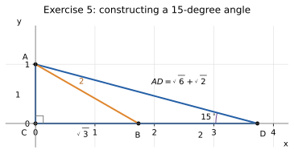
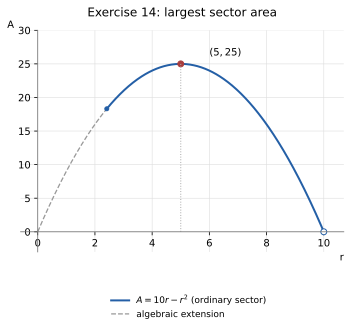
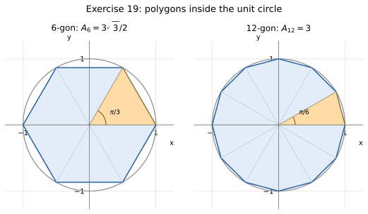
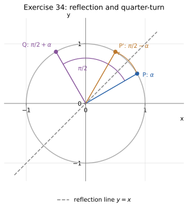
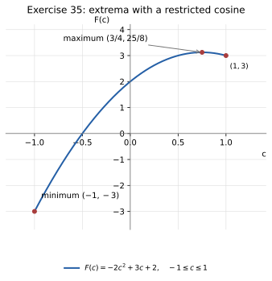

# Homework 5 Solutions

Based on [Lecture 5: Angles and Trigonometric Functions](../Notes/N5.md).

Angles without a degree symbol are in radians. Lengths without specified
units use the same units as the given lengths; areas use square units.

**Exercise 1.** A right triangle has an angle of
$30^\circ$ and hypotenuse $10$. Find the other two sides.

**Solution.** The side opposite $30^\circ$ is
$$
10\sin30^\circ=10\cdot\frac12=\boxed{5}.
$$
The other leg is
$$
10\cos30^\circ=10\cdot\frac{\sqrt3}{2}=\boxed{5\sqrt3}.
$$
Check: $5^2+(5\sqrt3)^2=25+75=100=10^2$.

**Exercise 2.** An equilateral triangle has side $s$. Show that
its altitude is $\dfrac{\sqrt3}{2}s$ and its area is $\dfrac{\sqrt3}{4}s^2$.

**Solution.** Let the equilateral triangle be $ABC$ and let $M$ be the midpoint of
$BC$. Triangles $ABM$ and $ACM$ are congruent by SSS: $AB=AC=s$,
$BM=CM=s/2$, and $AM$ is common. Thus $\angle AMB=\angle AMC$.
These adjacent angles sum to $180^\circ$, so each is $90^\circ$.
Consequently $AM$ is an altitude. If its length is $h$, then
$$
h^2+\left(\frac s2\right)^2=s^2,
\qquad h^2=\frac34s^2.
$$
Because $s>0$ and $h>0$,
$$
\boxed{h=\frac{\sqrt3}{2}s},\qquad
\boxed{A=\frac12sh=\frac{\sqrt3}{4}s^2}.
$$

**Exercise 3.** Evaluate without a calculator:
$\sin60^\circ\cos30^\circ+\cos60^\circ\sin30^\circ$, $\ \tan^245^\circ-\sin^230^\circ$,
$\ \dfrac{\tan60^\circ}{\tan30^\circ}$.

**Solution.** Substitute the special-angle values:
$$
\sin60^\circ\cos30^\circ+\cos60^\circ\sin30^\circ
=\frac{\sqrt3}{2}\cdot\frac{\sqrt3}{2}+\frac12\cdot\frac12
=\frac34+\frac14=\boxed{1},
$$
$$
\tan^245^\circ-\sin^230^\circ=1^2-\left(\frac12\right)^2
=\boxed{\frac34},
$$
$$
\frac{\tan60^\circ}{\tan30^\circ}
=\frac{\sqrt3}{1/\sqrt3}=\boxed{3}.
$$

**Exercise 4.** From a point $50$ m from the base of a tower,
the angle of elevation to the top is $60^\circ$. Find the height of the tower.
If the angle were $30^\circ$, what would the height be?

**Solution.** The horizontal distance is $50$ m, so $\tan\theta=h/50$. Thus
$$
\boxed{h=50\sqrt3\text{ m}}\quad(\theta=60^\circ),
\qquad
\boxed{h=\frac{50\sqrt3}{3}\text{ m}}\quad(\theta=30^\circ).
$$
These are approximately $86.60$ m and $28.87$ m, respectively. The model
measures the angle from the ground point, with no additional eye height.

**Exercise 5.** In right triangle $ABC$, $\angle C=90^\circ$,
$\angle B=30^\circ$, and $AC=1$. Extend side $CB$ past $B$ to a point $D$
with $BD=AB$. Show that $\angle ADC=15^\circ$, and use triangle $ACD$ to find
$\tan15^\circ$ and $\sin15^\circ$ exactly.

**Solution.** First $\angle A=60^\circ$. Since $AC=1$ is opposite $30^\circ$,
$$
AB=2,\qquad CB=\sqrt3,\qquad BD=AB=2.
$$
The rays $BC$ and $BD$ point in opposite directions, so
$\angle ABD=180^\circ-30^\circ=150^\circ$. Triangle $ABD$ is isosceles,
with $AB=BD$, hence
$$
\angle BAD=\angle ADB=\frac{180^\circ-150^\circ}{2}=15^\circ.
$$
The rays $DB$ and $DC$ coincide. Therefore $\boxed{\angle ADC=15^\circ}$.
In right triangle $ACD$,
$$
CD=CB+BD=\sqrt3+2,\qquad
AD=\sqrt{1+(2+\sqrt3)^2}=\sqrt{8+4\sqrt3}.
$$
Consequently,
$$
\boxed{\tan15^\circ=\frac1{2+\sqrt3}=2-\sqrt3},
$$
where rationalization uses $(2+\sqrt3)(2-\sqrt3)=1$. Also,
$$
\sin15^\circ=\frac1{\sqrt{8+4\sqrt3}}
=\frac1{\sqrt6+\sqrt2}
=\boxed{\frac{\sqrt6-\sqrt2}{4}}.
$$
Here $(\sqrt6+\sqrt2)^2=8+4\sqrt3$, and the positive square root is
appropriate because all lengths are positive.

{width=300px}

**Exercise 6.** From a point $A$ on level ground, the angle of elevation to
the top of a tower is $30^\circ$. After walking $20$ m straight toward the
tower, the angle of elevation is $60^\circ$. Find the height of the tower.

**Solution.** Let $d$ be the distance in meters from the second observation point to
the tower, and let $h$ be its height. Then
$$
\frac{h}{d+20}=\tan30^\circ=\frac1{\sqrt3},\qquad
\frac hd=\tan60^\circ=\sqrt3.
$$
Thus $h=(d+20)/\sqrt3=\sqrt3d$, so
$$
d+20=3d,\qquad d=10,\qquad \boxed{h=10\sqrt3\text{ m}}.
$$
The initial distance is $30$ m; both original tangent ratios check.

**Exercise 7.** Convert $150^\circ$ and $-45^\circ$ to radians,
and $\dfrac{7\pi}{6}$ and $\dfrac{5\pi}{12}$ to degrees.

**Solution.** Multiply degrees by $\pi/180$ and radians by $180/\pi$:
$$
150^\circ\cdot\frac\pi{180^\circ}=\boxed{\frac{5\pi}{6}},\qquad
-45^\circ\cdot\frac\pi{180^\circ}=\boxed{-\frac\pi4},
$$
$$
\frac{7\pi}{6}\cdot\frac{180^\circ}\pi=\boxed{210^\circ},\qquad
\frac{5\pi}{12}\cdot\frac{180^\circ}\pi=\boxed{75^\circ}.
$$
The first two answers are in radians.

**Exercise 8.** Find the angle in $[0,2\pi)$ that is coterminal
with $-\dfrac{5\pi}{3}$ and with $\dfrac{19\pi}{4}$.

**Solution.** Add or subtract full turns until the result lies in $[0,2\pi)$:
$$
-\frac{5\pi}{3}+2\pi=\boxed{\frac\pi3},\qquad
\frac{19\pi}{4}-4\pi=\boxed{\frac{3\pi}{4}}.
$$

**Exercise 9.** A sector of a circle of radius $10$ has
central angle $72^\circ$. Find its arc length and area.

**Solution.** Convert first: $72^\circ=72\pi/180=2\pi/5$ radians. Therefore
$$
\boxed{s=r\theta=10\cdot\frac{2\pi}{5}=4\pi},\qquad
\boxed{A=\frac12r^2\theta=\frac12\cdot100\cdot\frac{2\pi}{5}=20\pi}.
$$
Arc length is in the given length units; area is in their square units.

**Exercise 10.** List three angles coterminal with
$135^\circ$, including one negative angle.

**Solution.** Use $135^\circ+360^\circ k$ for integer $k$. Taking $k=-1,1,2$ gives
$$
\boxed{-225^\circ,\quad495^\circ,\quad855^\circ}.
$$
Each differs from $135^\circ$ by an integer multiple of $360^\circ$.

**Exercise 11.** A wheel of radius $0.4$ m turns through
$5$ radians. How far does a point on its rim travel? Through what angle in
degrees has the wheel turned?

**Solution.** The point travels along the circle through arc length
$$
\boxed{s=r\theta=0.4\cdot5=2\text{ m}}.
$$
The rotation in degrees is
$$
\boxed{5\cdot\frac{180^\circ}{\pi}=\frac{900}{\pi}{}^\circ
\approx286.48^\circ}.
$$
This is distance traveled along the rim, rather than the straight-line
displacement between the starting and ending positions.

**Exercise 12.** Find the radian measure of the angle between the
hour and minute hands at $4{:}00$, and the arc length cut off on a clock face
of radius $15$ cm.

**Solution.** At $4{:}00$, the hands are four of the twelve hour divisions apart.
The smaller angle is
$$
\boxed{\theta=\frac4{12}\cdot2\pi=\frac{2\pi}{3}\text{ radians}}.
$$
The corresponding shorter arc on a circle of radius $15$ cm has length
$$
\boxed{s=15\cdot\frac{2\pi}{3}=10\pi\text{ cm}}.
$$
If the larger angle is chosen instead, it is $4\pi/3$ radians and its arc
length is $20\pi$ cm.

**Exercise 13.** The minute hand turns through $2\pi$ radians every
hour and the hour hand through $2\pi$ radians every $12$ hours. Find each
hand's angular speed in radians per minute, and find the first time after
$3{:}00$ when the two hands point in the same direction.

**Solution.** Both hands rotate clockwise. Their angular speed magnitudes are
$$
\boxed{\omega_m=\frac{2\pi}{60}=\frac\pi{30}\text{ rad/min}},\qquad
\boxed{\omega_h=\frac{2\pi}{12\cdot60}=\frac\pi{360}\text{ rad/min}}.
$$
With counterclockwise angles defined as positive, their signed angular
velocities are $-\pi/30$ and $-\pi/360$ rad/min.

Let $t\ge0$ be the number of minutes after $3{:}00$, and measure clockwise
angles from the 12 o'clock position. The minute hand starts at angle $0$
and the hour hand starts at $\pi/2$. Coincidence requires
$$
\frac\pi{30}t=\frac\pi2+\frac\pi{360}t+2\pi k,
\qquad k\in\mathbb Z.
$$
Thus
$$
\frac{11\pi}{360}t=\frac\pi2+2\pi k,
\qquad t=\frac{180+720k}{11}.
$$
The least positive solution occurs at $k=0$:
$$
\boxed{t=\frac{180}{11}\text{ min}=16\frac4{11}\text{ min}}.
$$
The first coincidence is at $\boxed{3{:}16{:}21\frac9{11}}$, approximately
$3{:}16{:}21.82$. Indeed, the hands then have the same clockwise angle
$6\pi/11$.

**Exercise 14.** A sector of a circle has perimeter $20$ (two radii plus the
arc). Write its area as a function of the radius $r$, and find the radius and
central angle that give the largest possible area.

**Solution.** Let $s$ be the arc length and $\theta$ the central angle in radians.
The perimeter condition gives
$$
2r+s=20,\qquad s=20-2r.
$$
For a nondegenerate sector, $r>0$ and $s>0$, hence $0<r<10$. Therefore
$$
\boxed{A(r)=\frac12rs=10r-r^2=25-(r-5)^2}.
$$
Since $(r-5)^2\ge0$, $A(r)\le25$, with equality exactly when $r=5$.
At that radius $s=20-2(5)=10$, and
$$
\boxed{r=5,\qquad\theta=\frac sr=2\text{ radians},\qquad A_{\max}=25}.
$$
The radius is in length units and the area in square units.

For an ordinary sector without overlapping turns, one also requires
$0<\theta\le2\pi$. Since $\theta=20/r-2$, this restricts the feasible
radius to $10/(1+\pi)\le r<10$ (make the left endpoint strict if a full
circle is excluded). The maximizing radius $5$ is feasible in either
convention; the maximum is unchanged.

{width=300px}

**Exercise 15.** The point $(5,-12)$ lies on the
terminal side of $\theta$. Find all six trigonometric functions of $\theta$.

**Solution.** The distance from the origin is $r=\sqrt{5^2+(-12)^2}=13$. Thus
$$
\boxed{\sin\theta=-\frac{12}{13},\quad
\cos\theta=\frac5{13},\quad\tan\theta=-\frac{12}{5}},
$$
$$
\boxed{\csc\theta=-\frac{13}{12},\quad
\sec\theta=\frac{13}{5},\quad\cot\theta=-\frac5{12}}.
$$
All six are defined because both coordinates are nonzero. Their signs
agree with quadrant IV.

**Exercise 16.** The point $\left(-\dfrac{8}{17},y\right)$ lies
on the unit circle in quadrant III. Find $y$ and all six trigonometric
functions of the corresponding angle.

**Solution.** The unit-circle equation gives
$$
\left(-\frac8{17}\right)^2+y^2=1,
\qquad y^2=\frac{225}{289}.
$$
Quadrant III requires $y<0$, so $\boxed{y=-15/17}$. Because $r=1$,
$$
\boxed{\sin\theta=-\frac{15}{17},\quad
\cos\theta=-\frac8{17},\quad\tan\theta=\frac{15}{8}},
$$
$$
\boxed{\csc\theta=-\frac{17}{15},\quad
\sec\theta=-\frac{17}{8},\quad\cot\theta=\frac8{15}}.
$$

**Exercise 17.** The terminal side of $\theta$ lies on the line
$y=-2x$ in quadrant IV. Find $\sin\theta$, $\cos\theta$, and $\tan\theta$.

**Solution.** Choose $(x,y)=(1,-2)$, which lies on $y=-2x$ in quadrant IV. Then
$r=\sqrt{1+4}=\sqrt5$, and
$$
\boxed{\sin\theta=-\frac2{\sqrt5}=-\frac{2\sqrt5}{5},\quad
\cos\theta=\frac1{\sqrt5}=\frac{\sqrt5}{5},\quad
\tan\theta=-2}.
$$
Every other point on the same quadrant-IV ray gives the same ratios.

**Exercise 18.** Evaluate, or state that the value is
undefined: $\sin\pi$, $\cos\dfrac{3\pi}{2}$, $\tan\dfrac{\pi}{2}$, $\cot\pi$,
$\sec0$.

**Solution.** At $\pi$, the unit-circle point is $(-1,0)$; at $3\pi/2$ it is $(0,-1)$;
at $\pi/2$ it is $(0,1)$; at $0$ it is $(1,0)$. Therefore
$$
\boxed{\sin\pi=0,\qquad\cos\frac{3\pi}{2}=0},
$$
$$
\boxed{\tan\frac\pi2\text{ is undefined},\qquad
\cot\pi\text{ is undefined},\qquad\sec0=1}.
$$
Here $\tan(\pi/2)=1/0$ and $\cot\pi=(-1)/0$ have zero denominators.

**Exercise 19.** Show that the triangle with vertices $O(0,0)$, $(1,0)$,
and $(\cos\theta,\sin\theta)$, where $0<\theta<\pi$, has area
$\tfrac12\sin\theta$. Use this to find the area of a regular hexagon and of a
regular $12$-gon inscribed in the unit circle, and compare with the area of
the circle.

**Solution.** Use the segment from $(0,0)$ to $(1,0)$ as the base; its length is $1$.
For $0<\theta<\pi$, $\sin\theta>0$, so the perpendicular distance from
$(\cos\theta,\sin\theta)$ to the line containing the base is
$\sin\theta$. This holds even if the perpendicular foot lies outside the
base segment. Thus
$$
\boxed{A_{\triangle}=\frac12\cdot1\cdot\sin\theta=\frac12\sin\theta}.
$$
Join the center of a regular inscribed $n$-gon to its vertices. This
partitions it into $n$ congruent triangles with two radii of length $1$
and included angle $2\pi/n$. Rotating a triangle does not change its area,
so the result just proved gives
$$
A_n=\frac n2\sin\frac{2\pi}{n}.
$$
Consequently,
$$
\boxed{A_6=3\sin\frac\pi3=\frac{3\sqrt3}{2}\approx2.598},\qquad
\boxed{A_{12}=6\sin\frac\pi6=3}.
$$
The unit circle has area $\pi\approx3.142$. Therefore
$$
\frac{3\sqrt3}{2}<3<\pi.
$$
Both polygons lie inside the circle, and the $12$-gon gives a closer
approximation to its area. The respective deficits are
$\pi-3\sqrt3/2\approx0.544$ and $\pi-3\approx0.142$ square units.

{width=300px}

**Exercise 20.** Determine the quadrant of $\theta$ if
$\sin\theta<0$ and $\tan\theta>0$. If $\cos\theta=\dfrac{5}{13}$ and
$\sin\theta<0$, find $\sin\theta$ and $\tan\theta$.

**Solution.** For the first question, $\sin\theta<0$ puts the terminal side in III or IV.
Since $\tan\theta>0$ requires sine and cosine to have the same sign,
cosine is also negative. Thus $\boxed{\theta\text{ is in quadrant III}}$.

The second question gives a separate set of conditions. Now
$\cos\theta=5/13>0$ and $\sin\theta<0$, so $\theta$ is in IV. Then
$$
\sin^2\theta=1-\left(\frac5{13}\right)^2=\frac{144}{169},
$$
$$
\boxed{\sin\theta=-\frac{12}{13}},\qquad
\boxed{\tan\theta=\frac{-12/13}{5/13}=-\frac{12}{5}}.
$$

**Exercise 21.** Evaluate exactly:
$\sin\dfrac{7\pi}{4}$, $\ \cos\dfrac{2\pi}{3}$, $\ \tan\dfrac{11\pi}{6}$,
$\ \sin\left(-\dfrac{\pi}{3}\right)$, $\ \cos 210^\circ$.

**Solution.** Reduce each angle to its first-quadrant reference angle and attach the
quadrant sign:
$$
\sin\frac{7\pi}{4}=-\sin\frac\pi4=\boxed{-\frac{\sqrt2}{2}},\qquad
\cos\frac{2\pi}{3}=-\cos\frac\pi3=\boxed{-\frac12},
$$
$$
\tan\frac{11\pi}{6}=-\tan\frac\pi6=\boxed{-\frac{\sqrt3}{3}},\qquad
\sin\left(-\frac\pi3\right)=-\sin\frac\pi3=\boxed{-\frac{\sqrt3}{2}},
$$
$$
\cos210^\circ=-\cos30^\circ=\boxed{-\frac{\sqrt3}{2}}.
$$

**Exercise 22.** Evaluate exactly:
$\sin\dfrac{5\pi}{4}$, $\ \cos\dfrac{11\pi}{6}$, $\ \tan\dfrac{3\pi}{4}$,
$\ \sin 300^\circ$, $\ \cos\dfrac{17\pi}{3}$, $\ \tan\left(-\dfrac{7\pi}{6}\right)$.

**Solution.** Using symmetry and periodicity,
$$
\sin\frac{5\pi}{4}=-\sin\frac\pi4=\boxed{-\frac{\sqrt2}{2}},\qquad
\cos\frac{11\pi}{6}=\cos\frac\pi6=\boxed{\frac{\sqrt3}{2}},
$$
$$
\tan\frac{3\pi}{4}=-\tan\frac\pi4=\boxed{-1},\qquad
\sin300^\circ=-\sin60^\circ=\boxed{-\frac{\sqrt3}{2}}.
$$
Also $17\pi/3-4\pi=5\pi/3$, so
$$
\cos\frac{17\pi}{3}=\cos\frac{5\pi}{3}=\boxed{\frac12}.
$$
Finally, tangent has period $\pi$, hence
$$
\tan\left(-\frac{7\pi}{6}\right)
=\tan\left(-\frac\pi6\right)=\boxed{-\frac{\sqrt3}{3}}.
$$

**Exercise 23.** Without a calculator, state the sign of
$\sin 200^\circ$, $\cos 300^\circ$, $\tan\dfrac{5\pi}{6}$, and
$\sec\left(-\dfrac{\pi}{5}\right)$.

**Solution.** The quadrant determines each sign:

* $200^\circ$ is in III, so $\boxed{\sin200^\circ<0}$.
* $300^\circ$ is in IV, so $\boxed{\cos300^\circ>0}$.
* $5\pi/6$ is in II, so $\boxed{\tan(5\pi/6)<0}$.
* $-\pi/5$ is in IV, where cosine is positive; therefore its reciprocal
  satisfies $\boxed{\sec(-\pi/5)>0}$.

**Exercise 24.** Given $\tan\theta=-\dfrac{5}{12}$ and
$\sin\theta>0$, find the other five trigonometric functions of $\theta$.

**Solution.** A negative tangent and positive sine imply negative cosine, hence
quadrant II. Choose a terminal point $(-12,5)$, so $r=13$. The other five
functions are
$$
\boxed{\sin\theta=\frac5{13},\quad\cos\theta=-\frac{12}{13},\quad
\csc\theta=\frac{13}{5},\quad\sec\theta=-\frac{13}{12},\quad
\cot\theta=-\frac{12}{5}}.
$$
Their quotient checks: $(5/13)/(-12/13)=-5/12$.

**Exercise 25.** Use symmetry, not a calculator, to evaluate
$$
\sin1^\circ+\sin2^\circ+\sin3^\circ+\cdots+\sin359^\circ
\quad\text{and}\quad
\sum_{k=0}^{11}\cos\frac{k\pi}{6}.
$$

**Solution.** Reflection across the $x$-axis gives
$\sin(360^\circ-\alpha)=-\sin\alpha$. Pair the terms at $k^\circ$ and
$(360-k)^\circ$ for $k=1,\ldots,179$. The only remaining term is
$\sin180^\circ=0$. Thus
$$
\sum_{k=1}^{359}\sin k^\circ
=\sum_{k=1}^{179}\bigl(\sin k^\circ+\sin(360-k)^\circ\bigr)
+\sin180^\circ=\boxed{0}.
$$
For the cosine sum, pair index $k$ with $k+6$ for $k=0,\ldots,5$.
The angles differ by $\pi$, so a half-turn changes the sign of cosine:
$$
\sum_{k=0}^{11}\cos\frac{k\pi}{6}
=\sum_{k=0}^{5}\left(\cos\frac{k\pi}{6}
+\cos\left(\frac{k\pi}{6}+\pi\right)\right)=\boxed{0}.
$$
All twelve terms are used exactly once.

**Exercise 26.** Find all $\theta$ in $[0,2\pi)$ with
$2\sin^2\theta-\sin\theta-1=0$.

**Solution.** Factor the equation in $u=\sin\theta$:
$$
2u^2-u-1=(2u+1)(u-1)=0.
$$
Thus $\sin\theta=1$ or $\sin\theta=-1/2$. On $[0,2\pi)$, the first
condition gives $\theta=\pi/2$. The second gives the reference angle
$\pi/6$ in quadrants III and IV, namely $7\pi/6$ and $11\pi/6$.
Therefore all the solutions are
$$
\boxed{\theta\in\left\{\frac\pi2,\frac{7\pi}{6},\frac{11\pi}{6}\right\}}.
$$
Each sine value is a root of the factored polynomial, so all three check.

**Exercise 27.** If $\tan\theta=2$ and $\pi<\theta<\dfrac{3\pi}2$,
find $\sin\theta$ and $\cos\theta$.

**Solution.** In quadrant III, both coordinates are negative and tangent is positive.
Choose $(x,y)=(-1,-2)$, which gives $y/x=2$ and $r=\sqrt5$. Hence
$$
\boxed{\sin\theta=-\frac2{\sqrt5}=-\frac{2\sqrt5}{5},\qquad
\cos\theta=-\frac1{\sqrt5}=-\frac{\sqrt5}{5}}.
$$
Their squared values sum to $4/5+1/5=1$, and their quotient is $2$.

**Exercise 28.** Simplify $\sin\theta\,\sec\theta\,\cot\theta$ and
$(1+\sin\theta)(1-\sin\theta)$.

**Solution.** For the first expression, $\sec\theta$ requires $\cos\theta\ne0$, and
$\cot\theta$ requires $\sin\theta\ne0$. On this original domain,
$$
\sin\theta\,\sec\theta\,\cot\theta
=\sin\theta\cdot\frac1{\cos\theta}\cdot\frac{\cos\theta}{\sin\theta}
=\boxed{1}.
$$
The cancellation does not assign a value to the original expression at
excluded angles: its domain remains $\theta\ne k\pi/2$ for
$k\in\mathbb Z$.

The second expression is defined for every real $\theta$. By difference
of squares and the Pythagorean identity,
$$
(1+\sin\theta)(1-\sin\theta)=1-\sin^2\theta=\boxed{\cos^2\theta}.
$$

**Exercise 29.** Prove $\dfrac{\sec\theta-\cos\theta}{\sin\theta}=\tan\theta$
and $\dfrac{\cos\theta}{1-\sin\theta}=\dfrac{1+\sin\theta}{\cos\theta}$.

**Solution.** For the first identity, the original left side requires both
$\cos\theta\ne0$ and $\sin\theta\ne0$. Under those conditions,
$$
\frac{\sec\theta-\cos\theta}{\sin\theta}
=\frac{\frac1{\cos\theta}-\cos\theta}{\sin\theta}
=\frac{1-\cos^2\theta}{\sin\theta\cos\theta}
=\frac{\sin^2\theta}{\sin\theta\cos\theta}
=\frac{\sin\theta}{\cos\theta}=\boxed{\tan\theta}.
$$
Thus the identity holds on the original domain
$\theta\ne k\pi/2$, $k\in\mathbb Z$; simplification does not extend that
domain.

For the second identity, the common domain of the displayed sides is
$\cos\theta\ne0$. This also guarantees $\sin\theta\ne\pm1$, so both
$1-\sin\theta$ and $1+\sin\theta$ are nonzero. Multiply the left side by
$(1+\sin\theta)/(1+\sin\theta)$:
$$
\frac{\cos\theta}{1-\sin\theta}
=\frac{\cos\theta(1+\sin\theta)}{1-\sin^2\theta}
=\frac{\cos\theta(1+\sin\theta)}{\cos^2\theta}
=\boxed{\frac{1+\sin\theta}{\cos\theta}}.
$$
The left side by itself is defined whenever $\sin\theta\ne1$; in
particular, it is $0$ when $\sin\theta=-1$. The right side is undefined
there. The identity is asserted only where both sides are defined,
$\theta\ne\pi/2+k\pi$, $k\in\mathbb Z$.

**Exercise 30.** Write $\cos\theta$ and $\tan\theta$ in terms of
$\sin\theta=s$, assuming $\theta$ is in quadrant II.

**Solution.** Quadrant II requires $0<s<1$ and $\cos\theta<0$. From
$\cos^2\theta=1-s^2$,
$$
\boxed{\cos\theta=-\sqrt{1-s^2},\qquad
\tan\theta=-\frac{s}{\sqrt{1-s^2}}},\qquad 0<s<1.
$$
The square root is positive on this interval, so tangent is defined and
negative, as quadrant II requires.

**Exercise 31.** Use cofunction relations to show
$\sin20^\circ=\cos70^\circ$, and find $x$ if $\sin(3x)=\cos(x+10^\circ)$
with $0^\circ<x<30^\circ$.

**Solution.** The cofunction identity gives
$$
\sin20^\circ=\cos(90^\circ-20^\circ)=\boxed{\cos70^\circ}.
$$
For the equation, all angles below are in degrees. Rewrite it as
$$
\sin(3x)=\sin\bigl(90^\circ-(x+10^\circ)\bigr)
=\sin(80^\circ-x).
$$
Because $0^\circ<x<30^\circ$, both $3x$ and $80^\circ-x$ lie strictly
between $0^\circ$ and $90^\circ$. Sine is one-to-one on that interval:
on the first-quadrant unit-circle arc, the height increases strictly
as the angle increases. Therefore
$$
3x=80^\circ-x,\qquad4x=80^\circ,\qquad\boxed{x=20^\circ}.
$$
This lies in the required interval; substituting gives
$\sin60^\circ=\cos30^\circ=\sqrt3/2$. Injectivity proves there are no
other solutions in the interval.

**Exercise 32.** Use even/odd and periodicity to evaluate
$\cos\left(-\dfrac{\pi}{3}\right)$, $\sin\left(\dfrac{13\pi}{6}\right)$, and
$\tan\left(-\dfrac{5\pi}{4}\right)$.

**Solution.** Cosine is even, sine has period $2\pi$, and tangent is odd with period
$\pi$. Thus
$$
\cos\left(-\frac\pi3\right)=\cos\frac\pi3=\boxed{\frac12},
$$
$$
\sin\frac{13\pi}{6}=\sin\left(2\pi+\frac\pi6\right)=\boxed{\frac12},
$$
$$
\tan\left(-\frac{5\pi}{4}\right)
=-\tan\frac{5\pi}{4}=-\tan\frac\pi4=\boxed{-1}.
$$

**Exercise 33.** Suppose $\sin\theta+\cos\theta=\dfrac15$ and
$0<\theta<\pi$. Find $\sin\theta\cos\theta$, decide which quadrant $\theta$ is
in, and then find $\sin\theta$, $\cos\theta$, and $\tan\theta$.

**Solution.** Write $s=\sin\theta$ and $c=\cos\theta$. Squaring $s+c=1/5$ gives
$$
\frac1{25}=(s+c)^2=s^2+c^2+2sc=1+2sc,
$$
so
$$
\boxed{sc=-\frac{12}{25}}.
$$
Since $0<\theta<\pi$, $s>0$. The negative product then forces $c<0$,
so $\boxed{\theta\text{ is in quadrant II}}$.

Now
$$
(s-c)^2=s^2+c^2-2sc=1+\frac{24}{25}=\frac{49}{25}.
$$
Because $s>0$ and $c<0$, $s-c>0$, giving $s-c=7/5$. Add and subtract
this equation and $s+c=1/5$:
$$
2s=\frac85,\qquad2c=-\frac65.
$$
Therefore
$$
\boxed{\sin\theta=\frac45,\qquad\cos\theta=-\frac35,\qquad
\tan\theta=-\frac43}.
$$
Check: $4/5-3/5=1/5$, $16/25+9/25=1$, and the signs match quadrant II.

**Exercise 34.** Reflecting a point across the line $y=x$ swaps its
coordinates. Explain why this reflection sends the unit-circle point at angle
$\alpha$ to the point at angle $\frac\pi2-\alpha$, and deduce the cofunction
relations. Then use the quarter-turn $(x,y)\mapsto(-y,x)$ to show
$\sin\left(\frac\pi2+\alpha\right)=\cos\alpha$ and
$\cos\left(\frac\pi2+\alpha\right)=-\sin\alpha$.

**Solution.** Let $P=(\cos\alpha,\sin\alpha)$. Reflecting across $y=x$ interchanges
its coordinates, producing $P'=(\sin\alpha,\cos\alpha)$.
Geometrically, the reflecting line makes angle $\pi/4$ with the positive
$x$-axis. Reflection reverses a ray's signed angular displacement from
that line. A ray at angle $\alpha$ therefore goes to the ray at angle
$$
\frac\pi4-\left(\alpha-\frac\pi4\right)=\frac\pi2-\alpha
\pmod{2\pi}.
$$
Thus $P'$ is also the unit-circle point
$(\cos(\pi/2-\alpha),\sin(\pi/2-\alpha))$. Equating its coordinates
gives
$$
\boxed{\cos\left(\frac\pi2-\alpha\right)=\sin\alpha,\qquad
\sin\left(\frac\pi2-\alpha\right)=\cos\alpha}.
$$
This reflection argument applies to every real $\alpha$, including
angles outside quadrant I.

A counterclockwise quarter-turn adds $\pi/2$ to the angle and sends
$(x,y)$ to $(-y,x)$. Hence it sends $P$ to
$(-\sin\alpha,\cos\alpha)$, also equal to
$(\cos(\pi/2+\alpha),\sin(\pi/2+\alpha))$. Therefore
$$
\boxed{\sin\left(\frac\pi2+\alpha\right)=\cos\alpha,\qquad
\cos\left(\frac\pi2+\alpha\right)=-\sin\alpha}.
$$

{width=300px}

**Exercise 35.** Find the largest and smallest values of
$2\sin^2\theta+3\cos\theta$, and the values of $\cos\theta$ where they occur.
(Hint: write the expression in terms of $c=\cos\theta$, with $-1\le c\le1$.)

**Solution.** Set $c=\cos\theta$, so $-1\le c\le1$ and $\sin^2\theta=1-c^2$. Then
$$
2\sin^2\theta+3\cos\theta
=2(1-c^2)+3c
=-2\left(c-\frac34\right)^2+\frac{25}{8}.
$$
The squared term is nonnegative, so the largest value is
$$
\boxed{\frac{25}{8}\quad\text{when }\cos\theta=\frac34}.
$$
This value of cosine is feasible because $3/4\in[-1,1]$.

To prove the minimum over the whole interval, subtract the candidate
minimum $-3$ and factor:
$$
(-2c^2+3c+2)-(-3)=-2c^2+3c+5=(c+1)(5-2c).
$$
For $-1\le c\le1$, $c+1\ge0$ and $5-2c\ge3>0$. Thus the expression
is at least $-3$, with equality exactly when $c=-1$. Consequently,
$$
\boxed{\text{smallest value }=-3\quad\text{when }\cos\theta=-1}.
$$
As a check, the endpoint values are $-3$ at $c=-1$ and $3$ at $c=1$,
and the vertex value $25/8$ is larger than both.

{width=300px}
