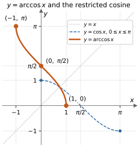
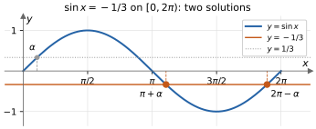
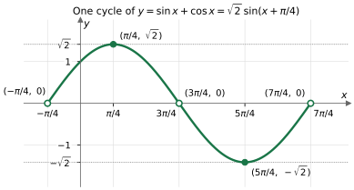
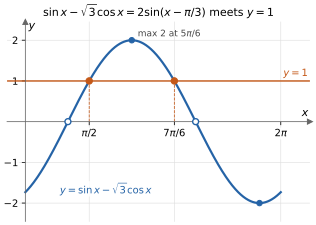

# Homework 8 Solutions

Based on [Lecture 8: Half-Angle Identities, Inverse Trigonometric Functions, and Combining Sine and Cosine](../Notes/N8.md).

Angles without a degree symbol are in radians, and $k\in\mathbb Z$ means that
$k$ is any integer.

## Section 1: Half-Angle Formulas

**Exercise 1.** Use half-angle formulas to find $\sin(\pi/12)$
and $\cos(\pi/12)$ exactly. Explain why both signs are positive.

**Solution.** Take $x=\pi/6$, so that $x/2=\pi/12$ and
$\cos x=\sqrt3/2$. Since $0<\pi/12<\pi/2$, the half angle
$\pi/12=15^\circ$ is in quadrant I. There the point
$(\cos(\pi/12),\sin(\pi/12))$ on the unit circle has both coordinates
positive, so **both** square roots take the $+$ sign. Inside each root,
multiply the numerator and denominator by $2$:
$$
\begin{aligned}
\sin\frac\pi{12}
&=\sqrt{\frac{1-\cos(\pi/6)}2}
=\sqrt{\frac{1-\sqrt3/2}{2}}
=\sqrt{\frac{2-\sqrt3}{4}}
=\boxed{\frac{\sqrt{2-\sqrt3}}2}\approx0.2588,\\
\cos\frac\pi{12}
&=\sqrt{\frac{1+\cos(\pi/6)}2}
=\sqrt{\frac{1+\sqrt3/2}{2}}
=\sqrt{\frac{2+\sqrt3}{4}}
=\boxed{\frac{\sqrt{2+\sqrt3}}2}\approx0.9659.
\end{aligned}
$$
Check: the squares add to $\frac{2-\sqrt3}4+\frac{2+\sqrt3}4=1$. The values
also agree with the difference-angle results of Lecture 7,
$\sin(\pi/12)=(\sqrt6-\sqrt2)/4$ and $\cos(\pi/12)=(\sqrt6+\sqrt2)/4$:
$$
\left(\frac{\sqrt6\mp\sqrt2}4\right)^2
=\frac{6+2\mp2\sqrt{12}}{16}
=\frac{8\mp4\sqrt3}{16}
=\frac{2\mp\sqrt3}4,
$$
and two positive numbers with the same square are equal.

**Exercise 2.** Suppose $\cos x=5/13$ and $3\pi/2<x<2\pi$.
Find $\sin(x/2)$, $\cos(x/2)$, and $\tan(x/2)$ exactly.
First locate $x/2$ in a quadrant.

**Solution.** Halve the entire given interval:
$$
\frac{3\pi}2<x<2\pi
\quad\Longrightarrow\quad
\frac{3\pi}4<\frac x2<\pi .
$$
So $x/2$ is in **quadrant II** (even though $x$ itself is in quadrant IV):
sine is positive, while cosine and tangent are negative. Therefore
$$
\sin\frac x2=+\sqrt{\frac{1-5/13}{2}}=\sqrt{\frac{8/13}{2}}=\sqrt{\frac4{13}}
=\boxed{\frac{2}{\sqrt{13}}=\frac{2\sqrt{13}}{13}}\approx0.5547,
$$
$$
\cos\frac x2=-\sqrt{\frac{1+5/13}{2}}=-\sqrt{\frac{18/13}{2}}=-\sqrt{\frac9{13}}
=\boxed{-\frac{3}{\sqrt{13}}=-\frac{3\sqrt{13}}{13}}\approx-0.8321,
$$
$$
\tan\frac x2=\frac{2/\sqrt{13}}{-3/\sqrt{13}}=\boxed{-\frac23}.
$$
Checks: $\sin^2(x/2)+\cos^2(x/2)=\frac4{13}+\frac9{13}=1$. Since $x$ is in
quadrant IV, $\sin x=-\sqrt{1-25/169}=-12/13$, and the rational form gives
$$
\tan\frac x2=\frac{\sin x}{1+\cos x}=\frac{-12/13}{18/13}=-\frac23,
$$
with no sign choice needed. Also
$2\sin(x/2)\cos(x/2)=2\cdot\frac2{\sqrt{13}}\cdot\left(-\frac3{\sqrt{13}}\right)
=-\frac{12}{13}=\sin x$.

**Exercise 3.** Find $\sin(5\pi/8)$ and $\cos(5\pi/8)$ exactly
by halving $5\pi/4$. Explain the different signs.

**Solution.** Take $x=5\pi/4$, so $\cos x=-\sqrt2/2$ and $x/2=5\pi/8$. Since
$\pi/2=4\pi/8<5\pi/8<8\pi/8=\pi$, the half angle is in quadrant II, where
sine is positive and cosine is negative. Watch the sign of $\cos x$ inside
the roots: $1-\cos x=1+\sqrt2/2$ and $1+\cos x=1-\sqrt2/2$.
$$
\sin\frac{5\pi}8=+\sqrt{\frac{1+\sqrt2/2}{2}}=\sqrt{\frac{2+\sqrt2}{4}}
=\boxed{\frac{\sqrt{2+\sqrt2}}2}\approx0.9239,
$$
$$
\cos\frac{5\pi}8=-\sqrt{\frac{1-\sqrt2/2}{2}}=-\sqrt{\frac{2-\sqrt2}{4}}
=\boxed{-\frac{\sqrt{2-\sqrt2}}2}\approx-0.3827.
$$
**Why the signs differ.** The signs come from the quadrant of the half
angle $5\pi/8$, not from $5\pi/4$. The point at angle $5\pi/8$ lies above
the $x$-axis and to the left of the $y$-axis, so its $y$-coordinate (sine) is
positive and its $x$-coordinate (cosine) is negative. Copying the signs of
$5\pi/4$, a quadrant III angle where sine and cosine are both negative, would
give the wrong sign for $\sin(5\pi/8)$.

Check: since $5\pi/8=\pi-3\pi/8$ and $3\pi/8=\pi/2-\pi/8$,
$$
\sin\frac{5\pi}8=\sin\frac{3\pi}8=\cos\frac\pi8=\frac{\sqrt{2+\sqrt2}}2,
\qquad
\cos\frac{5\pi}8=-\cos\frac{3\pi}8=-\sin\frac\pi8=-\frac{\sqrt{2-\sqrt2}}2,
$$
in agreement with the lecture's values of $\sin(\pi/8)$ and $\cos(\pi/8)$.

**Exercise 4.** Use $\tan(x/2)=\sin x/(1+\cos x)$ to show
$\tan(\pi/8)=\sqrt2-1$.

**Solution.** Take $x=\pi/4$; this is allowed because
$\pi/4\ne(2k+1)\pi$, so $1+\cos x\ne0$. Multiply the numerator and
denominator by $2$, then rationalize with the conjugate $2-\sqrt2$:
$$
\begin{aligned}
\tan\frac\pi8
&=\frac{\sin(\pi/4)}{1+\cos(\pi/4)}
=\frac{\sqrt2/2}{1+\sqrt2/2}
=\frac{\sqrt2}{2+\sqrt2}\\
&=\frac{\sqrt2\,(2-\sqrt2)}{(2+\sqrt2)(2-\sqrt2)}
=\frac{2\sqrt2-2}{4-2}
=\frac{2(\sqrt2-1)}{2}
=\boxed{\sqrt2-1}.
\end{aligned}
$$
Checks: $\pi/8$ is in quadrant I, so its tangent is positive, and indeed
$\sqrt2-1\approx0.4142>0$. With the lecture's values,
$$
\tan\frac\pi8=\frac{\sqrt{2-\sqrt2}}{\sqrt{2+\sqrt2}}
=\sqrt{\frac{(2-\sqrt2)^2}{(2+\sqrt2)(2-\sqrt2)}}
=\frac{2-\sqrt2}{\sqrt2}=\sqrt2-1 .
$$

**Exercise 5.** Explain why
$\sqrt{(1-\cos(2x))/2}=|\sin x|$, rather than always $\sin x$.
Evaluate both $\sqrt{(1-\cos(2x))/2}$ and $\sin x$ at $x=-\pi/6$.

**Solution.** From $\cos(2x)=1-2\sin^2x$, the power-reduction identity
$$
\frac{1-\cos(2x)}2=\sin^2x
$$
holds for **every** real $x$. Hence
$\sqrt{(1-\cos(2x))/2}=\sqrt{\sin^2x}$. The symbol $\sqrt{\ }$ always
denotes the **nonnegative** square root, and for every real number $t$,
$$
\sqrt{t^2}=\lvert t\rvert:
\qquad\text{if }t\ge0\text{ it is }t;\qquad
\text{if }t<0\text{ it is }-t>0,
$$
because in each case the number on the right is $\ge0$ and its square is
$t^2$. With $t=\sin x$,
$$
\boxed{\sqrt{\frac{1-\cos(2x)}2}=\lvert\sin x\rvert}.
$$
This equals $\sin x$ only when $\sin x\ge0$, that is, for
$2k\pi\le x\le\pi+2k\pi$; when $\sin x<0$ it equals $-\sin x$. This is
exactly why the half-angle formulas carry a $\pm$ sign that must be chosen
from the angle.

At $x=-\pi/6$: $\cos(2x)=\cos(-\pi/3)=\cos(\pi/3)=1/2$, so
$$
\sqrt{\frac{1-\cos(2x)}2}=\sqrt{\frac{1-1/2}{2}}=\sqrt{\frac14}=\boxed{\frac12},
\qquad
\sin\left(-\frac\pi6\right)=-\sin\frac\pi6=\boxed{-\frac12}.
$$
The two values differ in sign, and $\frac12=\left\lvert-\frac12\right\rvert$,
as predicted.

**Exercise 6.** At each of $x=0,\pi,2\pi$, decide which of
$\tan(x/2)$, $\sin x/(1+\cos x)$, and $(1-\cos x)/\sin x$
are defined. Evaluate those that are defined.

**Solution.** Use $\sin0=\sin\pi=\sin2\pi=0$, $\cos0=\cos2\pi=1$, and
$\cos\pi=-1$. A quotient is undefined whenever its denominator is $0$,
whatever the numerator is. Also $\tan(\pi/2)$ is undefined because
$\cos(\pi/2)=0$.

| $x$ | $\tan(x/2)$ | $\sin x/(1+\cos x)$ | $(1-\cos x)/\sin x$ |
|:--:|:--:|:--:|:--:|
| $0$ | $\tan0=0$ | $0/2=0$ | $0/0$: undefined |
| $\pi$ | $\tan(\pi/2)$: undefined | $0/0$: undefined | $2/0$: undefined |
| $2\pi$ | $\tan\pi=0$ | $0/2=0$ | $0/0$: undefined |

So:

* $x=0$ and $x=2\pi$: $\tan(x/2)$ and $\sin x/(1+\cos x)$ are defined and
  both equal $\boxed{0}$; $(1-\cos x)/\sin x$ is undefined.
* $x=\pi$: $\boxed{\text{none of the three is defined.}}$

This matches the stated domains: $\sin x/(1+\cos x)$ excludes
$x=(2k+1)\pi$ (here $x=\pi$), which are exactly the inputs where
$\tan(x/2)$ is undefined, while $(1-\cos x)/\sin x$ excludes every
$x=k\pi$ (all three inputs). Wherever two of the expressions are defined,
they agree.

## Section 2: Summary of Trigonometric Identities

**Exercise 7.** Rewrite $\cos(5x)\cos x$ as a sum of two cosine
terms, and $\sin(3x)\sin x$ as a difference of two cosine terms.

**Solution.** Adding and subtracting the cosine sum and difference formulas,
$$
\begin{aligned}
\cos(a-b)+\cos(a+b)
&=(\cos a\cos b+\sin a\sin b)+(\cos a\cos b-\sin a\sin b)=2\cos a\cos b,\\
\cos(a-b)-\cos(a+b)
&=(\cos a\cos b+\sin a\sin b)-(\cos a\cos b-\sin a\sin b)=2\sin a\sin b,
\end{aligned}
$$
which are the product-to-sum formulas of the lecture. With $a=5x$, $b=x$:
$$
\cos(5x)\cos x=\frac{\cos(5x-x)+\cos(5x+x)}2
=\boxed{\frac12\cos(4x)+\frac12\cos(6x)}.
$$
With $a=3x$, $b=x$:
$$
\sin(3x)\sin x=\frac{\cos(3x-x)-\cos(3x+x)}2
=\boxed{\frac12\cos(2x)-\frac12\cos(4x)}.
$$
Both hold for every real $x$. Check at $x=\pi/6$:
$\cos\frac{5\pi}6\cos\frac\pi6=-\frac{\sqrt3}2\cdot\frac{\sqrt3}2=-\frac34$ and
$\frac12\cos\frac{2\pi}3+\frac12\cos\pi=-\frac14-\frac12=-\frac34$;
$\sin\frac\pi2\sin\frac\pi6=\frac12$ and
$\frac12\cos\frac\pi3-\frac12\cos\frac{2\pi}3=\frac14+\frac14=\frac12$.

**Exercise 8.** Prove $\sin(3x)-\sin x=2\cos(2x)\sin x$.
Then find all real solutions of $\sin(3x)=\sin x$ by factoring.

**Solution.** *Proof of the identity.* Let $x$ be any real number. Write
$3x=2x+x$ and $x=2x-x$, and apply the sine sum and difference formulas with
$a=2x$, $b=x$:
$$
\begin{aligned}
\sin(3x)&=\sin(2x+x)=\sin(2x)\cos x+\cos(2x)\sin x,\\
\sin x&=\sin(2x-x)=\sin(2x)\cos x-\cos(2x)\sin x.
\end{aligned}
$$
Subtract the second line from the first. The terms $\sin(2x)\cos x$ cancel
and the terms $\cos(2x)\sin x$ double:
$$
\sin(3x)-\sin x
=\bigl[\sin(2x)\cos x+\cos(2x)\sin x\bigr]-\bigl[\sin(2x)\cos x-\cos(2x)\sin x\bigr]
=2\cos(2x)\sin x.
$$
Since $x$ was arbitrary, the identity holds for all real $x$.
$\blacksquare$ (This is the sum-to-product formula for $\sin u-\sin v$
with $u=3x$, $v=x$.)

*Solving.* Move everything to one side and use the identity:
$$
\sin(3x)=\sin x
\iff \sin(3x)-\sin x=0
\iff 2\cos(2x)\sin x=0 .
$$
A product is $0$ exactly when one of its factors is $0$.

* $\cos(2x)=0$: with $\beta=\arccos0=\pi/2$, $2x=\pm\pi/2+2k\pi$. These two
  families are the even and odd multiples of $\pi$ added to $\pi/2$, so
  together $2x=\pi/2+k\pi$, that is, $x=\dfrac\pi4+\dfrac{k\pi}2$.
* $\sin x=0$: with $\alpha=\arcsin0=0$, $x=2k\pi$ or $x=\pi+2k\pi$; together
  $x=k\pi$.

All real solutions:
$$
\boxed{x=k\pi\quad\text{or}\quad x=\frac\pi4+\frac{k\pi}2}.
$$
The families do not overlap: $\pi/4+k\pi/2=(2k+1)\pi/4$ is an odd multiple of
$\pi/4$, while $k\pi=4k\cdot\pi/4$ is an even one. On $[0,2\pi)$ the solutions
are $0,\ \pi/4,\ 3\pi/4,\ \pi,\ 5\pi/4,\ 7\pi/4$. Dividing by $\sin x$ instead
of factoring would have lost the family $x=k\pi$.

Check: $x=\pi/4$ gives $\sin(3\pi/4)=\sqrt2/2=\sin(\pi/4)$; $x=3\pi/4$ gives
$\sin(9\pi/4)=\sin(\pi/4)=\sqrt2/2=\sin(3\pi/4)$; $x=\pi$ gives
$\sin3\pi=0=\sin\pi$.

**Exercise 9.** Solve $\cos x\cos(3x)=\sin x\sin(3x)$ on
$[0,2\pi)$. Recognize an angle-sum formula after moving all terms
to one side.

**Solution.** Subtract $\sin x\sin(3x)$ and apply the cosine sum formula
with $a=x$, $b=3x$:
$$
\cos x\cos(3x)-\sin x\sin(3x)=0
\quad\Longrightarrow\quad
\cos(x+3x)=0
\quad\Longrightarrow\quad
\cos(4x)=0 .
$$
As in Exercise 8, $\cos u=0$ exactly when $u=\pi/2+k\pi$, so
$$
4x=\frac\pi2+k\pi
\quad\Longrightarrow\quad
x=\frac\pi8+\frac{k\pi}4 .
$$
For $0\le x<2\pi$, divide by $\pi/4$: $0\le\frac12+k<8$, so
$-\frac12\le k<\frac{15}2$, i.e. $k=0,1,\dots,7$. Hence
$$
\boxed{x=\frac\pi8,\ \frac{3\pi}8,\ \frac{5\pi}8,\ \frac{7\pi}8,\
\frac{9\pi}8,\ \frac{11\pi}8,\ \frac{13\pi}8,\ \frac{15\pi}8}.
$$
Eight solutions is the expected count: as $x$ runs over $[0,2\pi)$, the angle
$4x$ runs over $[0,8\pi)$, four full turns, and $\cos(4x)=0$ twice per turn.
Check at $x=\pi/8$: since $3\pi/8=\pi/2-\pi/8$, we have
$\cos(3\pi/8)=\sin(\pi/8)$ and $\sin(3\pi/8)=\cos(\pi/8)$, so both sides equal
$\cos(\pi/8)\sin(\pi/8)$.

## Section 3: Why Trigonometric Functions Need Restricted Domains

**Exercise 10.** Give two different angles with cosine $1/2$.
Which one is returned by $\arccos(1/2)$, and why?

**Solution.** $\cos(\pi/3)=1/2$, and since cosine is even and has period
$2\pi$,
$$
\cos\left(-\frac\pi3\right)=\cos\frac\pi3=\frac12,
\qquad
\cos\frac{5\pi}3=\cos\left(-\frac\pi3+2\pi\right)=\frac12 .
$$
So, for example, $\boxed{\pi/3\text{ and }5\pi/3}$ (or $-\pi/3$) both have
cosine $1/2$.

$\arccos(1/2)=\boxed{\pi/3}$. By definition, $\arccos u$ is the unique angle
in $[0,\pi]$ whose cosine is $u$. The angle $\pi/3$ lies in $[0,\pi]$; the
angles $-\pi/3<0$ and $5\pi/3>\pi$ do not. No other angle in $[0,\pi]$ works,
because cosine is decreasing on $[0,\pi]$ and so takes the value $1/2$ only
once there.

**Exercise 11.** Explain why $[0,\pi]$ is not a suitable interval for
defining inverse sine, even though it is suitable for inverse cosine.

**Solution.** To define an inverse function, the restricted sine must take
**each** value in $[-1,1]$ **exactly once**. On $[0,\pi]$ both parts fail.

* *Some values are taken twice.* $\sin(\pi/6)=\sin(5\pi/6)=1/2$ with both
  angles in $[0,\pi]$; more generally $\sin(\pi-\theta)=\sin\theta$, so every
  value $0\le c<1$ is taken twice. The restricted graph fails the horizontal
  line test, and "$\arcsin(1/2)$" would have two candidates.
* *Negative values are never taken.* For $0\le\theta\le\pi$ the point
  $(\cos\theta,\sin\theta)$ is on the upper half of the unit circle, so
  $\sin\theta\ge0$. A value such as $-1/2$ would have no output at all.

Cosine behaves differently on the same interval. As $\theta$ increases from
$0$ to $\pi$, the point moves counterclockwise along the upper semicircle from
$(1,0)$ to $(-1,0)$, and its $x$-coordinate $\cos\theta$ decreases steadily
from $1$ to $-1$. So cosine takes every value in $[-1,1]$ exactly once on
$[0,\pi]$. For sine, the lecture uses the right half of the circle instead,
$[-\pi/2,\pi/2]$, where $\sin\theta$ increases from $-1$ to $1$.

**Exercise 12.** Explain the difference between $\tan^{-1}(1)$ and
$1/\tan(\pi/4)$. Evaluate both.

**Solution.** In $\tan^{-1}(1)$ the superscript $-1$ means the **inverse
function**: $\tan^{-1}(1)=\arctan(1)$ is the angle $\theta$ in
$(-\pi/2,\pi/2)$ with $\tan\theta=1$. Since $\tan(\pi/4)=1$ and $\pi/4$ is in
that interval,
$$
\tan^{-1}(1)=\boxed{\frac\pi4}\approx0.7854\quad\text{(an angle).}
$$
The expression $1/\tan(\pi/4)$ is the **reciprocal** of a tangent value,
namely $\cot(\pi/4)$:
$$
\frac1{\tan(\pi/4)}=\frac11=\boxed{1}\quad\text{(a ratio).}
$$
The two numbers are different: $\pi/4\ne1$.

## Section 4: Principal Values, Domains, Ranges, and Graphs

**Exercise 13.** Evaluate exactly:
$\arcsin(\sqrt2/2)$, $\arccos(-1/2)$, $\arctan(\sqrt3)$,
$\arcsin(-1)$, and $\arccos(0)$.

**Solution.** In each case find the angle **in the principal range** with
the given value.

* $\arcsin(\sqrt2/2)=\boxed{\pi/4}$: $\sin(\pi/4)=\sqrt2/2$ and
  $\pi/4\in[-\pi/2,\pi/2]$.
* $\arccos(-1/2)=\boxed{2\pi/3}$: $\cos(2\pi/3)=-1/2$ and
  $2\pi/3\in[0,\pi]$. (Also $\arccos(-1/2)=\pi-\arccos(1/2)=\pi-\pi/3$.)
* $\arctan(\sqrt3)=\boxed{\pi/3}$:
  $\tan(\pi/3)=\dfrac{\sqrt3/2}{1/2}=\sqrt3$ and
  $\pi/3\in(-\pi/2,\pi/2)$.
* $\arcsin(-1)=\boxed{-\pi/2}$: $\sin(-\pi/2)=-1$ and $-\pi/2$ is the left
  endpoint of $[-\pi/2,\pi/2]$. (The angle $3\pi/2$ also has sine $-1$, but it
  is outside the range.)
* $\arccos(0)=\boxed{\pi/2}$: $\cos(\pi/2)=0$ and $\pi/2\in[0,\pi]$.

**Exercise 14.** Which expressions have real values?
$\arcsin(3/2)$, $\arccos(-1)$, $\arctan(100)$, and
$\arccos(-\sqrt2)$. Explain using domains.

**Solution.** Sine and cosine are coordinates of points on the unit
circle, so $-1\le\sin\theta\le1$ and $-1\le\cos\theta\le1$ for every real
$\theta$. That is why $\arcsin$ and $\arccos$ have domain $[-1,1]$, while
tangent takes every real value and $\arctan$ has domain $\mathbb R$.

* $\arcsin(3/2)$: $3/2>1$ is outside $[-1,1]$. No angle has sine $3/2$, so
  there is **no real value**.
* $\arccos(-1)$: $-1\in[-1,1]$, so it is **real**: $\arccos(-1)=\pi$, since
  $\cos\pi=-1$ and $\pi\in[0,\pi]$.
* $\arctan(100)$: every real number is in the domain of arctangent, so it is
  **real**. Since $100>1=\tan(\pi/4)$ and tangent is increasing on
  $(-\pi/2,\pi/2)$, we have $\pi/4<\arctan(100)<\pi/2$ (numerically
  $\approx1.5608$, just below $\pi/2\approx1.5708$).
* $\arccos(-\sqrt2)$: $-\sqrt2\approx-1.414<-1$ is outside $[-1,1]$, so there
  is **no real value**.

$$
\boxed{\text{Real: }\arccos(-1)=\pi\ \text{ and }\ \arctan(100);
\qquad\text{not real: }\arcsin(3/2),\ \arccos(-\sqrt2).}
$$

**Exercise 15.** Sketch $y=\arccos x$, marking its endpoints and
$y$-intercept. Explain why its graph is decreasing.

**Solution.** The domain is $[-1,1]$ and the range is $[0,\pi]$. The graph is
the reflection across $y=x$ of the restricted cosine graph $y=\cos x$,
$0\le x\le\pi$: each point $(a,b)$ becomes $(b,a)$.

{width=309px}

* Endpoints: $\cos\pi=-1$ and $\cos0=1$ give
  $\boxed{(-1,\pi)}$ and $\boxed{(1,0)}$. Both are included (closed dots),
  because $\arccos(-1)=\pi$ and $\arccos1=0$ are defined.
* $y$-intercept: $\arccos0=\pi/2$ gives $\boxed{(0,\pi/2)}$.
* Two more points from the lecture's table: $(1/2,\pi/3)$ and
  $(-1/2,2\pi/3)$.

The identity $\arccos(-u)=\pi-\arccos u$ shows that the points
$(u,\arccos u)$ and $(-u,\pi-\arccos u)$ have midpoint $(0,\pi/2)$, so the
graph is symmetric about its $y$-intercept.

**Why it is decreasing.** Cosine is decreasing on $[0,\pi]$. Let
$-1\le u_1<u_2\le1$, and put $\theta_1=\arccos u_1$, $\theta_2=\arccos u_2$,
both in $[0,\pi]$. If we had $\theta_1\le\theta_2$, then, because cosine is
decreasing on $[0,\pi]$, $\cos\theta_1\ge\cos\theta_2$, that is,
$u_1\ge u_2$, contradicting $u_1<u_2$. Hence $\theta_1>\theta_2$: a larger
input gives a smaller output, so $y=\arccos x$ is decreasing. In words: as the
angle runs from $0$ up to $\pi$, its cosine runs from $1$ down to $-1$;
reading this backward, as the cosine runs from $-1$ up to $1$, the angle runs
from $\pi$ down to $0$.

## Section 5: Compositions: When Do the Functions Cancel?

**Exercise 16.** Evaluate exactly:
$\arcsin(\sin(4\pi/3))$, $\arccos(\cos(-\pi/3))$, and
$\arctan(\tan(5\pi/6))$.

**Solution.** None of the three inner angles lies in the corresponding
principal range, so the functions do **not** simply cancel. Evaluate the
inside first, then find the principal angle.

* $4\pi/3\notin[-\pi/2,\pi/2]$. In quadrant III with reference angle
  $\pi/3$, $\sin(4\pi/3)=-\sqrt3/2$. Since $\sin(-\pi/3)=-\sqrt3/2$ and
  $-\pi/3\in[-\pi/2,\pi/2]$,
  $$
  \arcsin\left(\sin\frac{4\pi}3\right)=\arcsin\left(-\frac{\sqrt3}2\right)
  =\boxed{-\frac\pi3}.
  $$
* $-\pi/3\notin[0,\pi]$. Since cosine is even,
  $\cos(-\pi/3)=\cos(\pi/3)=1/2$, and $\pi/3\in[0,\pi]$:
  $$
  \arccos\left(\cos\left(-\frac\pi3\right)\right)=\arccos\frac12
  =\boxed{\frac\pi3}.
  $$
* $5\pi/6\notin(-\pi/2,\pi/2)$. Here
  $\tan(5\pi/6)=\dfrac{1/2}{-\sqrt3/2}=-\dfrac1{\sqrt3}$. Since
  $\tan(-\pi/6)=-1/\sqrt3$ and $-\pi/6\in(-\pi/2,\pi/2)$,
  $$
  \arctan\left(\tan\frac{5\pi}6\right)=\arctan\left(-\frac1{\sqrt3}\right)
  =\boxed{-\frac\pi6}.
  $$

Check: each answer has the same trigonometric value as the original angle,
by a symmetry: $\sin(\pi-\theta)=\sin\theta$ with $\pi-4\pi/3=-\pi/3$; cosine
is even; and tangent has period $\pi$, with $5\pi/6-\pi=-\pi/6$.

**Exercise 17.** Find $\sin(\arccos(-5/13))$ and
$\tan(\arcsin(3/5))$. State the principal range used in each case.

**Solution.** *First expression.* Let $\theta=\arccos(-5/13)$. Then
$\cos\theta=-5/13$ and $\boxed{0\le\theta\le\pi}$ (the range of arccosine).
On $[0,\pi]$ the point $(\cos\theta,\sin\theta)$ is on the upper half of the
unit circle, so $\sin\theta\ge0$ and the positive root is correct:
$$
\sin(\arccos(-5/13))=\sin\theta=\sqrt{1-\cos^2\theta}
=\sqrt{1-\frac{25}{169}}=\sqrt{\frac{144}{169}}=\boxed{\frac{12}{13}}.
$$
(In fact $\theta$ is in quadrant II, since its cosine is negative.)

*Second expression.* Let $\theta=\arcsin(3/5)$. Then $\sin\theta=3/5$ and
$\boxed{-\pi/2\le\theta\le\pi/2}$ (the range of arcsine). On this interval the
point is on the right half of the circle, so $\cos\theta\ge0$:
$$
\cos\theta=\sqrt{1-\frac9{25}}=\sqrt{\frac{16}{25}}=\frac45,
\qquad
\tan(\arcsin(3/5))=\frac{\sin\theta}{\cos\theta}=\frac{3/5}{4/5}
=\boxed{\frac34}.
$$
Check: $\arccos(-5/13)\approx1.9656$ and $\sin1.9656\approx0.9231\approx12/13$;
$\arcsin(0.6)\approx0.6435$ and $\tan0.6435\approx0.7500$.

**Exercise 18.** Simplify $\sin(\arctan(-2))$ exactly. Explain
why its sign must be negative.

**Solution.** Let $\theta=\arctan(-2)$. Then $\tan\theta=-2$ and
$-\pi/2<\theta<\pi/2$, where $\cos\theta>0$. From
$1+\tan^2\theta=\sec^2\theta=1/\cos^2\theta$,
$$
\cos^2\theta=\frac1{1+(-2)^2}=\frac15
\quad\Longrightarrow\quad
\cos\theta=\frac1{\sqrt5}\quad(\text{positive root, since }\cos\theta>0).
$$
Then
$$
\sin(\arctan(-2))=\sin\theta=\tan\theta\cos\theta
=(-2)\cdot\frac1{\sqrt5}=\boxed{-\frac2{\sqrt5}=-\frac{2\sqrt5}5}\approx-0.8944,
$$
in agreement with the lecture's formula
$\sin(\arctan t)=t/\sqrt{1+t^2}$ at $t=-2$.

**Why negative.** In $\sin\theta=\tan\theta\cdot\cos\theta$, the factor
$\cos\theta$ is positive on $(-\pi/2,\pi/2)$, so $\sin\theta$ has the same
sign as $\tan\theta=-2<0$. Geometrically, tangent is positive on
$(0,\pi/2)$ and zero at $0$, so $\tan\theta<0$ forces $\theta\in(-\pi/2,0)$,
a quadrant IV angle, where the $y$-coordinate (sine) is negative. A right
triangle with legs $1,2$ and hypotenuse $\sqrt5$ gives only the size
$2/\sqrt5$, not the sign. Numerically, $\arctan(-2)\approx-1.1071$ and
$\sin(-1.1071)\approx-0.8944$.

**Exercise 19.** Prove
$\arcsin u+\arccos u=\pi/2$ for $-1\le u\le1$.
Hint: put $\theta=\arcsin u$ and check both the cosine and the
range of $\pi/2-\theta$.

**Solution.** *Proof.* Fix $u$ with $-1\le u\le1$, and let
$\theta=\arcsin u$. By the definition of arcsine,
$$
\sin\theta=u\qquad\text{and}\qquad-\frac\pi2\le\theta\le\frac\pi2 .
$$
Consider the angle $\varphi=\dfrac\pi2-\theta$.

*Step 1: the cosine of $\varphi$ is $u$.* By the cosine difference formula
(equivalently, the complementary-angle identity),
$$
\cos\varphi=\cos\left(\frac\pi2-\theta\right)
=\cos\frac\pi2\cos\theta+\sin\frac\pi2\sin\theta
=0\cdot\cos\theta+1\cdot\sin\theta=\sin\theta=u .
$$

*Step 2: $\varphi$ lies in $[0,\pi]$.* Multiply
$-\pi/2\le\theta\le\pi/2$ by $-1$, which reverses both inequalities:
$-\pi/2\le-\theta\le\pi/2$. Adding $\pi/2$ to every part gives
$$
0\le\frac\pi2-\theta\le\pi,
\qquad\text{that is,}\qquad 0\le\varphi\le\pi .
$$

*Step 3: identify $\varphi$.* By definition, $\arccos u$ is the unique angle
in $[0,\pi]$ whose cosine is $u$; it is unique because cosine is decreasing
on $[0,\pi]$ and therefore takes the value $u$ only once there. Steps 1 and 2
show that $\varphi$ is an angle in $[0,\pi]$ whose cosine is $u$. Hence
$\varphi=\arccos u$, that is,
$$
\arccos u=\frac\pi2-\arcsin u,
\qquad\text{so}\qquad
\boxed{\arcsin u+\arccos u=\frac\pi2}.
$$
Since $u\in[-1,1]$ was arbitrary, the identity holds on the whole interval.
$\blacksquare$

Step 2 is essential: Step 1 alone does not identify $\varphi$, because
infinitely many angles have cosine $u$. Check: $u=\frac12$ gives
$\frac\pi6+\frac\pi3=\frac\pi2$; $u=-1$ gives $-\frac\pi2+\pi=\frac\pi2$;
$u=-\frac{\sqrt3}2$ gives $-\frac\pi3+\frac{5\pi}6=\frac\pi2$.

## Section 6: An Inverse Value Versus All Solutions

**Exercise 20.** Solve $\cos x=2/5$ on $[0,2\pi)$. Give exact
answers using inverse cosine.

**Solution.** Let $\beta=\arccos(2/5)$. Because cosine decreases on
$[0,\pi]$ and $\cos(\pi/2)=0<2/5<1=\cos0$, the principal angle satisfies
$0<\beta<\pi/2$. By the all-solutions table,
$$
x=\beta+2k\pi\quad\text{or}\quad x=-\beta+2k\pi .
$$
In $[0,2\pi)$: the first family gives only $\beta$ ($k=0$; $k=1$ gives
$\beta+2\pi\ge2\pi$). The second family gives only $2\pi-\beta$ ($k=1$; for
$k=0$, $-\beta<0$), which lies in $(3\pi/2,2\pi)$. Therefore
$$
\boxed{x=\arccos\frac25\quad\text{or}\quad x=2\pi-\arccos\frac25},
$$
approximately $1.1593$ and $5.1239$. These are in quadrants I and IV, where
cosine is positive, as it must be. Check:
$\cos(2\pi-\beta)=\cos(-\beta)=\cos\beta=2/5$.

**Exercise 21.** Find all real solutions of $\tan(3x)=2$.

**Solution.** Let $\gamma=\arctan2$; since $2>1=\tan(\pi/4)$, we have
$\pi/4<\gamma<\pi/2$. With $u=3x$, the table gives $\tan u=2$ exactly when
$u=\gamma+k\pi$. So
$$
3x=\arctan2+k\pi
\quad\Longrightarrow\quad
\boxed{x=\frac13\arctan2+\frac{k\pi}3},
$$
approximately $x\approx0.3690+1.0472\,k$. Dividing by $3$ divides the spacing:
consecutive solutions are $\pi/3$ apart, the period of $\tan(3x)$.

Domain: $\tan(3x)$ requires $\cos(3x)\ne0$. Every candidate has
$3x=\gamma+k\pi$ with $-\pi/2<\gamma<\pi/2$, which is never an odd multiple of
$\pi/2$, so no candidate is excluded. Check:
$\tan\bigl(3\cdot\frac13\arctan2\bigr)=\tan(\arctan2)=2$, and adding
$\pi/3$ to $x$ adds $\pi$ to $3x$, which does not change the tangent.

**Exercise 22.** Solve $\sin x=-1/3$ on $[0,2\pi)$.
Use $\alpha=\arcsin(1/3)$ to express two positive angles.

**Solution.** Let $\alpha=\arcsin(1/3)$. Since $0<1/3<1$, we have
$0<\alpha<\pi/2$ (numerically $\alpha\approx0.3398$). The principal angle for
the value $-1/3$ is
$$
\arcsin\left(-\frac13\right)=-\alpha,
$$
because $\sin(-\alpha)=-\sin\alpha=-1/3$ and $-\alpha\in[-\pi/2,\pi/2]$. By
the all-solutions table,
$$
x=-\alpha+2k\pi\quad\text{or}\quad x=\pi-(-\alpha)+2k\pi=\pi+\alpha+2k\pi .
$$

{width=461px}

In $[0,2\pi)$: the first family gives $2\pi-\alpha$ ($k=1$; $k=0$ gives a
negative angle), and the second gives $\pi+\alpha$ ($k=0$). Hence
$$
\boxed{x=\pi+\arcsin\frac13\quad\text{or}\quad x=2\pi-\arcsin\frac13},
$$
approximately $3.4814$ and $5.9433$. Check:
$\sin(\pi+\alpha)=-\sin\alpha=-1/3$ and
$\sin(2\pi-\alpha)=\sin(-\alpha)=-1/3$. The angles are in quadrants III and
IV, where sine is negative. Giving only $\arcsin(-1/3)=-\alpha$ would be wrong
twice over: it is negative, so not in $[0,2\pi)$, and it is only one angle.

## Section 7: Why $\sin x+\cos x$ Is Still a Sine Wave

**Exercise 23.** Rewrite $\sin x-\cos x$ as a single shifted
sine function. State its amplitude, period, and range.

**Solution.** Use the sine difference formula with $\cos(\pi/4)=\sin(\pi/4)=\sqrt2/2$:
$$
\sin\left(x-\frac\pi4\right)
=\sin x\cos\frac\pi4-\cos x\sin\frac\pi4
=\frac{\sqrt2}{2}(\sin x-\cos x).
$$
Multiplying by $\sqrt2$ (and using $\sqrt2\cdot\sqrt2/2=1$) gives
$$
\boxed{\sin x-\cos x=\sqrt2\sin\left(x-\frac\pi4\right)}.
$$
This is the sine graph shifted $\pi/4$ to the **right** and stretched
vertically by $\sqrt2$:
$$
\text{amplitude}=\boxed{\sqrt2},\qquad
\text{period}=\boxed{2\pi},\qquad
\text{range}=\boxed{[-\sqrt2,\sqrt2]}.
$$
(In the notation of Section 8: $a=1$, $b=-1$, $R=\sqrt2$, and
$\cos\phi=\sqrt2/2$, $\sin\phi=-\sqrt2/2$ give $\phi=-\pi/4$.)
Check: at $x=3\pi/4$, $\sin\frac{3\pi}4-\cos\frac{3\pi}4
=\frac{\sqrt2}2+\frac{\sqrt2}2=\sqrt2=\sqrt2\sin\frac\pi2$; at $x=\pi/4$ both
sides are $0$.

**Exercise 24.** Sketch one cycle of $\sin x+\cos x$, starting
at $x=-\pi/4$. Mark five key points a quarter-period apart.

**Solution.** By Section 7 of the lecture,
$\sin x+\cos x=\sqrt2\sin(x+\pi/4)$: amplitude $\sqrt2$, period $2\pi$,
midline $y=0$. A sine cycle starts where its input is $0$; here
$x+\pi/4=0$ at $x=-\pi/4$, so the cycle runs from $-\pi/4$ to
$-\pi/4+2\pi=7\pi/4$. The key points are a quarter-period, $\pi/2$, apart.
At $x=-\pi/4,\ \pi/4,\ 3\pi/4,\ 5\pi/4,\ 7\pi/4$ the inner angle $x+\pi/4$ is
$0,\ \pi/2,\ \pi,\ 3\pi/2,\ 2\pi$, so the pattern is zero, maximum, zero,
minimum, zero:
$$
\boxed{\left(-\frac\pi4,0\right),\quad
\left(\frac\pi4,\sqrt2\right),\quad
\left(\frac{3\pi}4,0\right),\quad
\left(\frac{5\pi}4,-\sqrt2\right),\quad
\left(\frac{7\pi}4,0\right)}.
$$

{width=519px}

Check directly with $\sin x+\cos x$:
$$
\begin{aligned}
x=-\pi/4:&\quad -\sqrt2/2+\sqrt2/2=0, &
x=\pi/4:&\quad \sqrt2/2+\sqrt2/2=\sqrt2,\\
x=3\pi/4:&\quad \sqrt2/2-\sqrt2/2=0, &
x=5\pi/4:&\quad -\sqrt2/2-\sqrt2/2=-\sqrt2,\\
x=7\pi/4:&\quad -\sqrt2/2+\sqrt2/2=0. &&
\end{aligned}
$$
The graph also passes through the $y$-intercept $(0,1)$, since
$\sin0+\cos0=1$.

**Exercise 25.** Solve $\sin x+\cos x=-1$ on $[0,2\pi)$.

**Solution.** Rewrite the left side:
$$
\sqrt2\sin\left(x+\frac\pi4\right)=-1
\quad\Longrightarrow\quad
\sin\left(x+\frac\pi4\right)=-\frac1{\sqrt2}=-\frac{\sqrt2}2 .
$$
Let $u=x+\pi/4$. For $0\le x<2\pi$, the inner angle satisfies
$\pi/4\le u<9\pi/4$. The principal angle is
$\arcsin(-\sqrt2/2)=-\pi/4$, so all solutions of $\sin u=-\sqrt2/2$ are
$$
u=-\frac\pi4+2k\pi\quad\text{or}\quad u=\pi+\frac\pi4+2k\pi=\frac{5\pi}4+2k\pi .
$$
In $[\pi/4,9\pi/4)$ these give $u=7\pi/4$ (from $k=1$ in the first family)
and $u=5\pi/4$ (from $k=0$ in the second); the neighbors $-\pi/4$,
$15\pi/4$, and $13\pi/4$ are outside. Subtracting $\pi/4$,
$$
\boxed{x=\pi\quad\text{or}\quad x=\frac{3\pi}2}.
$$
Check: $\sin\pi+\cos\pi=0+(-1)=-1$ and
$\sin\frac{3\pi}2+\cos\frac{3\pi}2=-1+0=-1$. In the graph of Exercise 24,
these are the two points at height $-1$ on either side of the minimum at
$5\pi/4$.

**Exercise 26.** Explain why $\sin x+\cos x=3/2$ has no real
solutions, even though each term is at most $1$.

**Solution.** The separate bounds $\sin x\le1$ and $\cos x\le1$ only give
$\sin x+\cos x\le2$, which does not rule out $3/2$. But that bound is never
reached, because the two terms are linked by $\sin^2x+\cos^2x=1$: whenever
$\sin x=1$, we have $\cos x=0$. The true maximum comes from the shifted form:
for every real $x$,
$$
\sin x+\cos x=\sqrt2\sin\left(x+\frac\pi4\right)\le\sqrt2 .
$$
And $\sqrt2<3/2$, because both numbers are positive and
$(\sqrt2)^2=2<\frac94=\left(\frac32\right)^2$. Hence
$$
\sin x+\cos x\le\sqrt2<\frac32\quad\text{for all real }x,
$$
so the equation has $\boxed{\text{no real solutions}}$.

Second check, without the shifted form: if $\sin x+\cos x=3/2$, squaring
gives $\sin^2x+\cos^2x+2\sin x\cos x=9/4$, that is,
$1+\sin(2x)=9/4$, so $\sin(2x)=5/4>1$, which is impossible.

## Section 8: The General Combination $a\sin x+b\cos x$

**Exercise 27.** Write $\sqrt3\sin x+\cos x$ as a single shifted
sine. State its maximum value and all inputs where it is attained.

**Solution.** Here $a=\sqrt3$ and $b=1$, so
$$
R=\sqrt{(\sqrt3)^2+1^2}=\sqrt4=2,\qquad
\cos\phi=\frac{\sqrt3}2,\qquad\sin\phi=\frac12 .
$$
Since $a>0$, $\phi=\arctan(b/a)=\arctan(1/\sqrt3)=\pi/6$; indeed
$\cos(\pi/6)=\sqrt3/2$ and $\sin(\pi/6)=1/2$. Therefore
$$
\boxed{\sqrt3\sin x+\cos x=2\sin\left(x+\frac\pi6\right)}.
$$
Verify: $2\left(\sin x\cos\frac\pi6+\cos x\sin\frac\pi6\right)
=2\left(\frac{\sqrt3}2\sin x+\frac12\cos x\right)=\sqrt3\sin x+\cos x$.

Since $\sin(x+\pi/6)\le1$, the maximum value is $\boxed{2}$, attained exactly
when $\sin(x+\pi/6)=1$:
$$
x+\frac\pi6=\frac\pi2+2k\pi
\quad\Longrightarrow\quad
\boxed{x=\frac\pi3+2k\pi}.
$$
Check: $\sqrt3\sin\frac\pi3+\cos\frac\pi3=\sqrt3\cdot\frac{\sqrt3}2+\frac12
=\frac32+\frac12=2$.

**Exercise 28.** Write $5\sin x-12\cos x$ as $R\sin(x+\phi)$
with $R>0$ and $-\pi/2<\phi<0$. State its range.

**Solution.** Here $a=5$ and $b=-12$, so
$$
R=\sqrt{5^2+(-12)^2}=\sqrt{169}=13,\qquad
\cos\phi=\frac5{13}>0,\qquad\sin\phi=-\frac{12}{13}<0,
$$
so $\phi$ is a quadrant IV angle. Since $a>0$, the quadrant rule gives
$\phi=\arctan(b/a)=\arctan(-12/5)=-\arctan(12/5)$, which lies in
$(-\pi/2,0)$ as required. Confirm both values with the lecture's formulas for
$t=-12/5$, where $\sqrt{1+t^2}=\sqrt{169/25}=13/5$:
$$
\cos\phi=\frac1{\sqrt{1+t^2}}=\frac5{13},\qquad
\sin\phi=\frac t{\sqrt{1+t^2}}=\frac{-12/5}{13/5}=-\frac{12}{13}.
$$
Therefore
$$
\boxed{5\sin x-12\cos x=13\sin\left(x-\arctan\frac{12}5\right)},
\qquad \phi=-\arctan\frac{12}5\approx-1.1760,
$$
and the range is $\boxed{[-13,13]}$.
Verify: $13\sin(x+\phi)=(13\cos\phi)\sin x+(13\sin\phi)\cos x
=5\sin x-12\cos x$.

**Exercise 29.** Find the amplitude, period, and range of
$3\sin(2x)+4\cos(2x)-1$.

**Solution.** Combine the two terms with the same frequency $B=2$. With
$a=3$, $b=4$:
$$
R=\sqrt{3^2+4^2}=5,\qquad \cos\phi=\frac35,\quad\sin\phi=\frac45,
\qquad \phi=\arctan\frac43\ \ (a>0).
$$
Then $5\sin(2x+\phi)=(5\cos\phi)\sin(2x)+(5\sin\phi)\cos(2x)
=3\sin(2x)+4\cos(2x)$, so
$$
3\sin(2x)+4\cos(2x)-1=5\sin\left(2x+\arctan\frac43\right)-1 .
$$
This is a sinusoid with midline $y=-1$ and
$$
\text{amplitude}=\boxed{5},\qquad
\text{period}=\frac{2\pi}2=\boxed{\pi},\qquad
\text{range}=[-1-5,\,-1+5]=\boxed{[-6,4]}.
$$
Check the maximum: at $2x=\pi/2-\phi$ we have
$\sin(2x)=\cos\phi=3/5$ and $\cos(2x)=\sin\phi=4/5$, so the expression is
$3\cdot\frac35+4\cdot\frac45-1=\frac{9+16}5-1=4$. Similarly, at
$2x=3\pi/2-\phi$ it is $-\frac95-\frac{16}5-1=-6$.

**Exercise 30.** For which real numbers $c$ does
$3\sin x+4\cos x=c$ have a real solution? Explain using the range.

**Solution.** From the lecture's example,
$3\sin x+4\cos x=5\sin(x+\phi)$ with $\phi=\arctan(4/3)$
($\cos\phi=3/5$, $\sin\phi=4/5$).

* *If $\lvert c\rvert>5$, there is no solution.* For every real $x$,
  $-1\le\sin(x+\phi)\le1$, so $-5\le3\sin x+4\cos x\le5$, and $c$ lies outside
  these values.
* *If $-5\le c\le5$, there is a solution.* Then $c/5\in[-1,1]$, so
  $\alpha=\arcsin(c/5)$ is defined, and $x=\alpha-\phi$ works:
  $$
  3\sin x+4\cos x=5\sin(\alpha-\phi+\phi)=5\sin\alpha=5\cdot\frac c5=c .
  $$

Therefore the equation has a real solution exactly when
$$
\boxed{-5\le c\le5},
$$
that is, exactly when $c$ is in the range $[-5,5]$ of the left side. For
example, $c=5$ is reached at $x=\pi/2-\phi$, where
$3\cos\phi+4\sin\phi=\frac95+\frac{16}5=5$, while $c=6$ is never reached.

**Exercise 31.** Find all real solutions of
$\sin x-\sqrt3\cos x=1$ by combining the left side into a single
sine function.

**Solution.** Here $a=1$ and $b=-\sqrt3$, so
$$
R=\sqrt{1+3}=2,\qquad\cos\phi=\frac12,\qquad\sin\phi=-\frac{\sqrt3}2 .
$$
Since $a>0$, $\phi=\arctan(-\sqrt3)=-\pi/3$; indeed
$\cos(-\pi/3)=1/2$ and $\sin(-\pi/3)=-\sqrt3/2$. Thus
$$
\sin x-\sqrt3\cos x=2\sin\left(x-\frac\pi3\right).
$$
Verify: $2\left(\sin x\cos\frac\pi3-\cos x\sin\frac\pi3\right)
=2\left(\frac12\sin x-\frac{\sqrt3}2\cos x\right)=\sin x-\sqrt3\cos x$.

{width=422px}

The equation becomes $2\sin(x-\pi/3)=1$, or $\sin(x-\pi/3)=1/2$. With
$u=x-\pi/3$ and principal angle $\arcsin(1/2)=\pi/6$,
$$
u=\frac\pi6+2k\pi\quad\text{or}\quad u=\pi-\frac\pi6+2k\pi=\frac{5\pi}6+2k\pi .
$$
Add $\pi/3$:
$$
\boxed{x=\frac\pi2+2k\pi\quad\text{or}\quad x=\frac{7\pi}6+2k\pi}.
$$
Check: $x=\pi/2$ gives $1-\sqrt3\cdot0=1$; $x=7\pi/6$ gives
$-\frac12-\sqrt3\left(-\frac{\sqrt3}2\right)=-\frac12+\frac32=1$. Adding
$2k\pi$ changes neither sine nor cosine.
