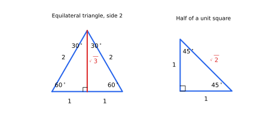
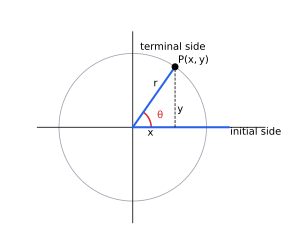
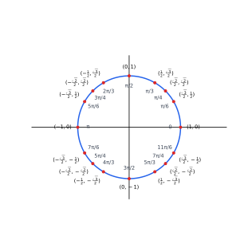
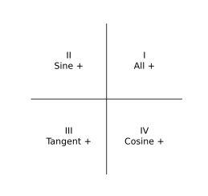

## Lecture 5: Angles and Trigonometric Functions

Trigonometry began as the study of triangles, but its functions describe
anything that rotates or repeats: wheels, waves, tides, and sound. This
lecture begins with right triangles and the exact values at $30^\circ$,
$45^\circ$, and $60^\circ$, then defines angles of any size, extends sine,
cosine, and tangent to all angles using a point on a circle, and studies their
signs, symmetries, and basic identities.

### 1. Right-Triangle Trigonometry and Special Triangles

For an acute angle $\theta$ in a right triangle,
$$
\sin\theta=\frac{\text{opposite}}{\text{hypotenuse}},\quad
\cos\theta=\frac{\text{adjacent}}{\text{hypotenuse}},\quad
\tan\theta=\frac{\text{opposite}}{\text{adjacent}}.
$$
These ratios depend only on $\theta$, since right triangles with the same
acute angle are similar. Two triangles give exact values.

**The $45^\circ$-$45^\circ$-$90^\circ$ triangle.** Cut a square of side $1$
along a diagonal. The two legs are $1$ and $1$, and by the Pythagorean theorem
the hypotenuse is $\sqrt{1^2+1^2}=\sqrt2$. The acute angles are equal, each
$45^\circ$. Therefore
$$
\sin45^\circ=\frac1{\sqrt2}=\frac{\sqrt2}2,\qquad
\cos45^\circ=\frac{\sqrt2}2,\qquad
\tan45^\circ=1.
$$

**The $30^\circ$-$60^\circ$-$90^\circ$ triangle.** Start with an equilateral
triangle of side $2$, whose angles are all $60^\circ$. Drop the altitude from
one vertex to the opposite side. It bisects the base and the vertex angle, so
it creates a right triangle with angles $30^\circ$ and $60^\circ$, hypotenuse
$2$, shorter leg $1$ (half the base), and longer leg
$\sqrt{2^2-1^2}=\sqrt3$. The shorter leg is opposite $30^\circ$ and the
longer leg is opposite $60^\circ$, so
$$
\sin30^\circ=\frac12,\quad\cos30^\circ=\frac{\sqrt3}2,\quad\tan30^\circ=\frac1{\sqrt3}=\frac{\sqrt3}3,
$$
$$
\sin60^\circ=\frac{\sqrt3}2,\quad\cos60^\circ=\frac12,\quad\tan60^\circ=\sqrt3.
$$

{width=420px}

| Triangle | Side ratios (short leg : long leg : hypotenuse) |
|:--|:--:|
| $45^\circ$-$45^\circ$-$90^\circ$ | $1:1:\sqrt2$ |
| $30^\circ$-$60^\circ$-$90^\circ$ | $1:\sqrt3:2$ |

Notice $\sin\theta=\cos(90^\circ-\theta)$: the side opposite one acute angle
is adjacent to the other.

**Example.** A ladder of length $12$ leans against a wall at $60^\circ$ with
the ground. It reaches height $12\sin60^\circ=6\sqrt3$ and its base is
$12\cos60^\circ=6$ from the wall.

**Exercise 1.** A right triangle has an angle of
$30^\circ$ and hypotenuse $10$. Find the other two sides.

**Exercise 2.** An equilateral triangle has side $s$. Show that
its altitude is $\dfrac{\sqrt3}{2}s$ and its area is $\dfrac{\sqrt3}{4}s^2$.

**Exercise 3.** Evaluate without a calculator:
$\sin60^\circ\cos30^\circ+\cos60^\circ\sin30^\circ$, $\ \tan^245^\circ-\sin^230^\circ$,
$\ \dfrac{\tan60^\circ}{\tan30^\circ}$.

**Exercise 4.** From a point $50$ m from the base of a tower,
the angle of elevation to the top is $60^\circ$. Find the height of the tower.
If the angle were $30^\circ$, what would the height be?

**Exercise 5.** In right triangle $ABC$, $\angle C=90^\circ$,
$\angle B=30^\circ$, and $AC=1$. Extend side $CB$ past $B$ to a point $D$
with $BD=AB$. Show that $\angle ADC=15^\circ$, and use triangle $ACD$ to find
$\tan15^\circ$ and $\sin15^\circ$ exactly.

**Exercise 6.** From a point $A$ on level ground, the angle of elevation to
the top of a tower is $30^\circ$. After walking $20$ m straight toward the
tower, the angle of elevation is $60^\circ$. Find the height of the tower.

### 2. Angles and Their Measures

An **angle** is formed by rotating a ray, called the **initial side**, about
its endpoint, the **vertex**, to a final position called the **terminal
side**. A counterclockwise rotation gives a **positive** angle; a clockwise
rotation gives a **negative** angle.

An angle is in **standard position** when its vertex is at the origin and its
initial side lies along the positive $x$-axis. Its terminal side then lies in
a quadrant or on an axis (a **quadrantal angle**, such as $0$, $\pi/2$, $\pi$,
$3\pi/2$).

{width=300px}

**Degrees and radians.** One full turn is $360^\circ$. In **radian** measure,
the angle $\theta$ equals the length $s$ of the arc it cuts off on a circle of
radius $r$, divided by $r$:
$$
\theta=\frac{s}{r}.
$$
One full turn cuts off the whole circumference $2\pi r$, so it measures
$2\pi$ radians. Hence
$$
\boxed{180^\circ=\pi\text{ radians}},
\qquad
\text{degrees}\to\text{radians: }\times\frac{\pi}{180},
\qquad
\text{radians}\to\text{degrees: }\times\frac{180}{\pi}.
$$

| Degrees | $0^\circ$ | $30^\circ$ | $45^\circ$ | $60^\circ$ | $90^\circ$ | $180^\circ$ | $270^\circ$ | $360^\circ$ |
|:--:|:--:|:--:|:--:|:--:|:--:|:--:|:--:|:--:|
| Radians | $0$ | $\frac{\pi}{6}$ | $\frac{\pi}{4}$ | $\frac{\pi}{3}$ | $\frac{\pi}{2}$ | $\pi$ | $\frac{3\pi}{2}$ | $2\pi$ |

**Coterminal angles.** Two angles in standard position are **coterminal** if
they have the same terminal side. They differ by whole turns:
$$
\theta+360^\circ k
\quad\text{or}\quad
\theta+2\pi k,\qquad k\in\mathbb Z.
$$

**Arc length and sector area** (with $\theta$ in radians):
$$
s=r\theta,\qquad A=\tfrac12r^2\theta.
$$
These formulas are valid only in radians; this is the main reason radians are
the natural unit in calculus.

**Example.** A circle has radius $6$. The arc cut off by $\theta=\dfrac{2\pi}{3}$
has length $s=6\cdot\dfrac{2\pi}3=4\pi$, and the sector has area
$A=\tfrac12\cdot36\cdot\dfrac{2\pi}{3}=12\pi$.

**Exercise 7.** Convert $150^\circ$ and $-45^\circ$ to radians,
and $\dfrac{7\pi}{6}$ and $\dfrac{5\pi}{12}$ to degrees.

**Exercise 8.** Find the angle in $[0,2\pi)$ that is coterminal
with $-\dfrac{5\pi}{3}$ and with $\dfrac{19\pi}{4}$.

**Exercise 9.** A sector of a circle of radius $10$ has
central angle $72^\circ$. Find its arc length and area.

**Exercise 10.** List three angles coterminal with
$135^\circ$, including one negative angle.

**Exercise 11.** A wheel of radius $0.4$ m turns through
$5$ radians. How far does a point on its rim travel? Through what angle in
degrees has the wheel turned?

**Exercise 12.** Find the radian measure of the angle between the
hour and minute hands at $4{:}00$, and the arc length cut off on a clock face
of radius $15$ cm.

**Exercise 13.** The minute hand turns through $2\pi$ radians every
hour and the hour hand through $2\pi$ radians every $12$ hours. Find each
hand's angular speed in radians per minute, and find the first time after
$3{:}00$ when the two hands point in the same direction.

**Exercise 14.** A sector of a circle has perimeter $20$ (two radii plus the
arc). Write its area as a function of the radius $r$, and find the radius and
central angle that give the largest possible area.

### 3. Trigonometric Functions of Any Angle

Let $\theta$ be an angle in standard position and let $P(x,y)\neq(0,0)$ be any
point on its terminal side, with distance
$$
r=\sqrt{x^2+y^2}>0
$$
from the origin. The six **trigonometric functions** are
$$
\sin\theta=\frac yr,\qquad
\cos\theta=\frac xr,\qquad
\tan\theta=\frac yx,
$$
$$
\csc\theta=\frac ry,\qquad
\sec\theta=\frac rx,\qquad
\cot\theta=\frac xy.
$$
A ratio is undefined when its denominator is $0$. The values do not depend on
which point $P$ is chosen, because different points on the same ray give
similar triangles and hence equal ratios.

**Unit circle.** Choosing $P$ on the circle $x^2+y^2=1$ gives $r=1$, so
$$
\boxed{\cos\theta=x,\qquad\sin\theta=y},
\qquad
\tan\theta=\frac{\sin\theta}{\cos\theta}.
$$
The point on the unit circle at angle $\theta$ is $(\cos\theta,\sin\theta)$.

**Example.** The point $P(-3,4)$ lies on the terminal side of $\theta$. Then
$r=\sqrt{9+16}=5$, so
$$
\sin\theta=\frac45,\quad\cos\theta=-\frac35,\quad\tan\theta=-\frac43.
$$

**Special angles.** From the $45^\circ$-$45^\circ$-$90^\circ$ triangle (sides
$1,1,\sqrt2$) and the $30^\circ$-$60^\circ$-$90^\circ$ triangle (sides
$1,\sqrt3,2$):

| $\theta$ | $0$ | $\frac{\pi}{6}$ | $\frac{\pi}{4}$ | $\frac{\pi}{3}$ | $\frac{\pi}{2}$ |
|:--:|:--:|:--:|:--:|:--:|:--:|
| $\sin\theta$ | $0$ | $\frac12$ | $\frac{\sqrt2}{2}$ | $\frac{\sqrt3}{2}$ | $1$ |
| $\cos\theta$ | $1$ | $\frac{\sqrt3}{2}$ | $\frac{\sqrt2}{2}$ | $\frac12$ | $0$ |
| $\tan\theta$ | $0$ | $\frac{\sqrt3}{3}$ | $1$ | $\sqrt3$ | undefined |

A memory aid: $\sin\theta=\frac{\sqrt n}{2}$ for $n=0,1,2,3,4$ at
$0,\frac\pi6,\frac\pi4,\frac\pi3,\frac\pi2$, and cosine runs in reverse.

{width=380px}

**Exercise 15.** The point $(5,-12)$ lies on the
terminal side of $\theta$. Find all six trigonometric functions of $\theta$.

**Exercise 16.** The point $\left(-\dfrac{8}{17},y\right)$ lies
on the unit circle in quadrant III. Find $y$ and all six trigonometric
functions of the corresponding angle.

**Exercise 17.** The terminal side of $\theta$ lies on the line
$y=-2x$ in quadrant IV. Find $\sin\theta$, $\cos\theta$, and $\tan\theta$.

**Exercise 18.** Evaluate, or state that the value is
undefined: $\sin\pi$, $\cos\dfrac{3\pi}{2}$, $\tan\dfrac{\pi}{2}$, $\cot\pi$,
$\sec0$.

**Exercise 19.** Show that the triangle with vertices $O(0,0)$, $(1,0)$,
and $(\cos\theta,\sin\theta)$, where $0<\theta<\pi$, has area
$\tfrac12\sin\theta$. Use this to find the area of a regular hexagon and of a
regular $12$-gon inscribed in the unit circle, and compare with the area of
the circle.

### 4. Signs of the Functions and Reduction by Symmetry

Since $r>0$, the sign of each function is decided by the signs of $x$ and $y$
in the quadrant containing the terminal side:

| Quadrant | $x$ | $y$ | $\sin$ | $\cos$ | $\tan$ |
|:--:|:--:|:--:|:--:|:--:|:--:|
| I | $+$ | $+$ | $+$ | $+$ | $+$ |
| II | $-$ | $+$ | $+$ | $-$ | $-$ |
| III | $-$ | $-$ | $-$ | $-$ | $+$ |
| IV | $+$ | $-$ | $-$ | $+$ | $-$ |

The reciprocal functions $\csc,\sec,\cot$ share the sign of $\sin,\cos,\tan$
respectively.

**ASTC rule.** Going counterclockwise from quadrant I, the phrase
"**A**ll **S**tudents **T**ake **C**alculus" lists which functions are
positive: **A**ll in I, **S**ine (and $\csc$) in II, **T**angent (and $\cot$)
in III, **C**osine (and $\sec$) in IV.

{width=240px}

**Odd and even.** Reflecting the terminal point $(x,y)$ across the $x$-axis
gives $(x,-y)$, which corresponds to the angle $-\theta$. Hence
$$
\cos(-\theta)=\cos\theta\ \ (\text{even}),\qquad
\sin(-\theta)=-\sin\theta,\quad\tan(-\theta)=-\tan\theta\ \ (\text{odd}).
$$

**Periodicity.** Adding a full turn returns to the same terminal point:
$$
\sin(\theta+2\pi)=\sin\theta,\qquad\cos(\theta+2\pi)=\cos\theta.
$$
Tangent repeats twice as fast, since $(x,y)$ and $(-x,-y)$ (the angles
$\theta$ and $\theta+\pi$) give the same ratio:
$$
\tan(\theta+\pi)=\tan\theta.
$$
The **period** of $\sin$ and $\cos$ is $2\pi$; the period of $\tan$ is $\pi$.

**Reduction by symmetry.** Every angle can be traced back to an acute angle in
quadrant I. First use periodicity to move the angle into $[0,2\pi)$ by adding
or subtracting multiples of $2\pi$. If the terminal side lies in quadrant I,
there is nothing more to do. Otherwise let $\alpha$ $\left(0<\alpha<\frac\pi2\right)$
be the acute angle between the terminal side and the $x$-axis, and let
$P(x,y)$ be the unit-circle point at angle $\alpha$. The unit-circle point at
$\theta$ is the image of $P$ under one symmetry of the circle:

* **Quadrant II: $\theta=\pi-\alpha$, reflect across the $y$-axis.** The
  reflection turns the angle $\alpha$ measured from the positive $x$-axis into
  the angle $\alpha$ measured from the negative $x$-axis, which is
  $\pi-\alpha$. The point $(x,y)$ becomes $(-x,y)$, so
$$
\sin(\pi-\alpha)=\sin\alpha,\quad
\cos(\pi-\alpha)=-\cos\alpha,\quad
\tan(\pi-\alpha)=-\tan\alpha.
$$
* **Quadrant III: $\theta=\pi+\alpha$, half-turn about the origin.** Rotating
  by half a turn adds $\pi$ to the angle and sends $(x,y)$ to the opposite
  point $(-x,-y)$ (central symmetry through the origin), so
$$
\sin(\pi+\alpha)=-\sin\alpha,\quad
\cos(\pi+\alpha)=-\cos\alpha,\quad
\tan(\pi+\alpha)=\tan\alpha.
$$
* **Quadrant IV: $\theta=2\pi-\alpha$, reflect across the $x$-axis.** This is
  the odd/even reflection above: $(x,y)$ becomes $(x,-y)$, the point at angle
  $-\alpha$, which is coterminal with $2\pi-\alpha$. So
$$
\sin(2\pi-\alpha)=-\sin\alpha,\quad
\cos(2\pi-\alpha)=\cos\alpha,\quad
\tan(2\pi-\alpha)=-\tan\alpha.
$$

{width=100%}

| Quadrant | $\alpha$ | Symmetry | Point | $\sin\theta$ | $\cos\theta$ | $\tan\theta$ |
|:--------:|:----------:|:------------------------:|:-----------:|:----------:|:----------:|:----------:|
| II | $\pi-\theta$ | across the $y$-axis | $(-x,y)$ | $\sin\alpha$ | $-\cos\alpha$ | $-\tan\alpha$ |
| III | $\theta-\pi$ | half-turn about $O$ | $(-x,-y)$ | $-\sin\alpha$ | $-\cos\alpha$ | $\tan\alpha$ |
| IV | $2\pi-\theta$ | across the $x$-axis | $(x,-y)$ | $-\sin\alpha$ | $\cos\alpha$ | $-\tan\alpha$ |

Each symmetry changes only the signs of the coordinates, never their sizes.
So every trigonometric value at $\theta$ equals the value at $\alpha$ up to a
sign, and the sign is the one the quadrant requires (ASTC). In practice:
reduce into $[0,2\pi)$, find the quadrant and $\alpha$, evaluate at $\alpha$,
then attach the sign.

**Example.** Find $\sin$, $\cos$, and $\tan$ at $\dfrac{5\pi}{6}$,
$\dfrac{4\pi}{3}$, and $\dfrac{7\pi}{4}$.

* $\dfrac{5\pi}6=\pi-\dfrac\pi6$ is in quadrant II. Reflecting
  $\left(\frac{\sqrt3}2,\frac12\right)$ across the $y$-axis gives
  $\left(-\frac{\sqrt3}2,\frac12\right)$, so
$$
\sin\frac{5\pi}6=\frac12,\qquad
\cos\frac{5\pi}6=-\frac{\sqrt3}2,\qquad
\tan\frac{5\pi}6=-\frac{\sqrt3}3.
$$
* $\dfrac{4\pi}3=\pi+\dfrac\pi3$ is in quadrant III. The half-turn sends
  $\left(\frac12,\frac{\sqrt3}2\right)$ to $\left(-\frac12,-\frac{\sqrt3}2\right)$,
  so
$$
\sin\frac{4\pi}3=-\frac{\sqrt3}2,\qquad
\cos\frac{4\pi}3=-\frac12,\qquad
\tan\frac{4\pi}3=\sqrt3.
$$
* $\dfrac{7\pi}4=2\pi-\dfrac\pi4$ is in quadrant IV. Reflecting
  $\left(\frac{\sqrt2}2,\frac{\sqrt2}2\right)$ across the $x$-axis gives
  $\left(\frac{\sqrt2}2,-\frac{\sqrt2}2\right)$, so
$$
\sin\frac{7\pi}4=-\frac{\sqrt2}2,\qquad
\cos\frac{7\pi}4=\frac{\sqrt2}2,\qquad
\tan\frac{7\pi}4=-1.
$$

**Example.** Find $\sin\left(-\dfrac{2\pi}{3}\right)$ and $\cos510^\circ$.

* $-\dfrac{2\pi}3+2\pi=\dfrac{4\pi}3=\pi+\dfrac\pi3$, in quadrant III, so
  $\sin\left(-\dfrac{2\pi}3\right)=-\sin\dfrac\pi3=-\dfrac{\sqrt3}2$.
* $510^\circ-360^\circ=150^\circ=180^\circ-30^\circ$, in quadrant II, so
  $\cos510^\circ=-\cos30^\circ=-\dfrac{\sqrt3}2$.

**Example.** Given $\sin\theta=\dfrac35$ and $\cos\theta<0$, find $\cos\theta$
and $\tan\theta$. Sine positive and cosine negative place $\theta$ in
quadrant II. A reference triangle has $y=3$, $r=5$, so $|x|=4$, and since
$x<0$,
$$
\cos\theta=-\frac45,\qquad\tan\theta=-\frac34.
$$

**Exercise 20.** Determine the quadrant of $\theta$ if
$\sin\theta<0$ and $\tan\theta>0$. If $\cos\theta=\dfrac{5}{13}$ and
$\sin\theta<0$, find $\sin\theta$ and $\tan\theta$.

**Exercise 21.** Evaluate exactly:
$\sin\dfrac{7\pi}{4}$, $\ \cos\dfrac{2\pi}{3}$, $\ \tan\dfrac{11\pi}{6}$,
$\ \sin\left(-\dfrac{\pi}{3}\right)$, $\ \cos 210^\circ$.

**Exercise 22.** Evaluate exactly:
$\sin\dfrac{5\pi}{4}$, $\ \cos\dfrac{11\pi}{6}$, $\ \tan\dfrac{3\pi}{4}$,
$\ \sin 300^\circ$, $\ \cos\dfrac{17\pi}{3}$, $\ \tan\left(-\dfrac{7\pi}{6}\right)$.

**Exercise 23.** Without a calculator, state the sign of
$\sin 200^\circ$, $\cos 300^\circ$, $\tan\dfrac{5\pi}{6}$, and
$\sec\left(-\dfrac{\pi}{5}\right)$.

**Exercise 24.** Given $\tan\theta=-\dfrac{5}{12}$ and
$\sin\theta>0$, find the other five trigonometric functions of $\theta$.

**Exercise 25.** Use symmetry, not a calculator, to evaluate
$$
\sin1^\circ+\sin2^\circ+\sin3^\circ+\cdots+\sin359^\circ
\quad\text{and}\quad
\sum_{k=0}^{11}\cos\frac{k\pi}{6}.
$$

**Exercise 26.** Find all $\theta$ in $[0,2\pi)$ with
$2\sin^2\theta-\sin\theta-1=0$.

### 5. Basic Properties and Identities

**Pythagorean identity.** Since $(\cos\theta,\sin\theta)$ lies on the unit
circle $x^2+y^2=1$,
$$
\boxed{\sin^2\theta+\cos^2\theta=1}.
$$
Dividing by $\cos^2\theta$ or $\sin^2\theta$ gives
$$
1+\tan^2\theta=\sec^2\theta,\qquad
1+\cot^2\theta=\csc^2\theta.
$$

**Reciprocal and quotient identities.**
$$
\csc\theta=\frac1{\sin\theta},\quad
\sec\theta=\frac1{\cos\theta},\quad
\cot\theta=\frac1{\tan\theta}=\frac{\cos\theta}{\sin\theta}.
$$

**Range.** For every real $\theta$,
$$
-1\le\sin\theta\le1,\qquad-1\le\cos\theta\le1,
$$
because $x$ and $y$ are coordinates on the unit circle. Tangent takes every
real value.

**Odd/even and periodicity** were established in Section 4. Together with the
cofunction relations
$$
\sin\left(\frac\pi2-\theta\right)=\cos\theta,\qquad
\cos\left(\frac\pi2-\theta\right)=\sin\theta,
$$
they give most simplifications.

**Example.** If $\sin\theta=-\dfrac{2}{3}$ and $\theta$ is in quadrant III,
find $\cos\theta$. From $\cos^2\theta=1-\dfrac49=\dfrac59$ and cosine
negative in III,
$$
\cos\theta=-\frac{\sqrt5}{3}.
$$

**Example (simplifying).** Show $\dfrac{1-\cos^2\theta}{\sin\theta}=\sin\theta$.
Since $1-\cos^2\theta=\sin^2\theta$, the left side is
$\dfrac{\sin^2\theta}{\sin\theta}=\sin\theta$ for $\sin\theta\neq0$.

**Exercise 27.** If $\tan\theta=2$ and $\pi<\theta<\dfrac{3\pi}2$,
find $\sin\theta$ and $\cos\theta$.

**Exercise 28.** Simplify $\sin\theta\,\sec\theta\,\cot\theta$ and
$(1+\sin\theta)(1-\sin\theta)$.

**Exercise 29.** Prove $\dfrac{\sec\theta-\cos\theta}{\sin\theta}=\tan\theta$
and $\dfrac{\cos\theta}{1-\sin\theta}=\dfrac{1+\sin\theta}{\cos\theta}$.

**Exercise 30.** Write $\cos\theta$ and $\tan\theta$ in terms of
$\sin\theta=s$, assuming $\theta$ is in quadrant II.

**Exercise 31.** Use cofunction relations to show
$\sin20^\circ=\cos70^\circ$, and find $x$ if $\sin(3x)=\cos(x+10^\circ)$
with $0^\circ<x<30^\circ$.

**Exercise 32.** Use even/odd and periodicity to evaluate
$\cos\left(-\dfrac{\pi}{3}\right)$, $\sin\left(\dfrac{13\pi}{6}\right)$, and
$\tan\left(-\dfrac{5\pi}{4}\right)$.

**Exercise 33.** Suppose $\sin\theta+\cos\theta=\dfrac15$ and
$0<\theta<\pi$. Find $\sin\theta\cos\theta$, decide which quadrant $\theta$ is
in, and then find $\sin\theta$, $\cos\theta$, and $\tan\theta$.

**Exercise 34.** Reflecting a point across the line $y=x$ swaps its
coordinates. Explain why this reflection sends the unit-circle point at angle
$\alpha$ to the point at angle $\frac\pi2-\alpha$, and deduce the cofunction
relations. Then use the quarter-turn $(x,y)\mapsto(-y,x)$ to show
$\sin\left(\frac\pi2+\alpha\right)=\cos\alpha$ and
$\cos\left(\frac\pi2+\alpha\right)=-\sin\alpha$.

**Exercise 35.** Find the largest and smallest values of
$2\sin^2\theta+3\cos\theta$, and the values of $\cos\theta$ where they occur.
(Hint: write the expression in terms of $c=\cos\theta$, with $-1\le c\le1$.)
