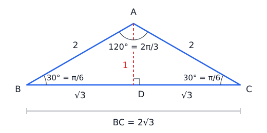
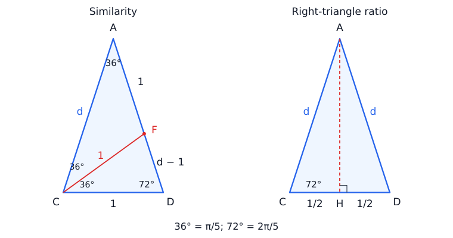
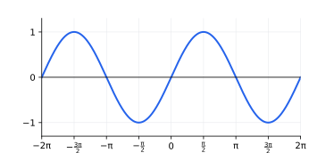
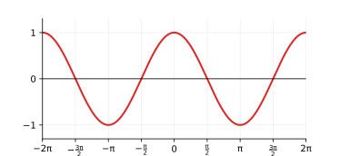
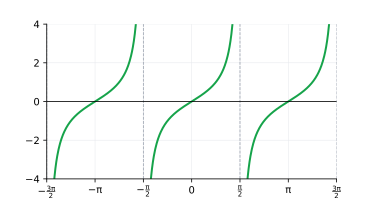

## Lecture 6: Trigonometric Functions and Their Properties

Lecture 5 defined trigonometric functions using the unit circle. We begin
with a $120^\circ$ ($2\pi/3$) isosceles triangle to see how sine and cosine
connect angles and side lengths beyond right triangles, then use another
isosceles triangle to calculate $\sin72^\circ=\sin(2\pi/5)$ exactly.
We then study trigonometric
functions as functions of a real variable: their graphs, domains, ranges,
symmetries, and periods. Finally, we shift and stretch the graphs and
solve simple trigonometric equations.

Unless a degree symbol appears, **all angles are in radians**. Throughout
this lecture, $k\in\mathbb Z$ means that $k$ is any integer.

### 1. A $120^\circ$ Isosceles Triangle: The Sine and Cosine Laws

Let $ABC$ be an isosceles triangle with $AB=AC=2$ and vertex angle
$\angle A=120^\circ=2\pi/3$. The two base angles are equal, so
$$
\angle B=\angle C=\frac{180^\circ-120^\circ}{2}=30^\circ=\frac\pi6.
$$
Drop the altitude $AD$ to the base $BC$. In an isosceles triangle this
altitude also bisects the base and the vertex angle. Thus $ABD$ and $ACD$
are $30^\circ$-$60^\circ$-$90^\circ$ triangles (angles $\pi/6$, $\pi/3$,
and $\pi/2$ in radians) with hypotenuse $2$, giving
$$
AD=1,\qquad BD=DC=\sqrt3,\qquad \boxed{BC=2\sqrt3}.
$$

{width=420px}

The original triangle is obtuse, so right-triangle ratios cannot be applied
directly to it. The **sine law** and **cosine law** relate the sides and
angles of any triangle. We demonstrate both laws on this triangle, using
the unit-circle values from Lecture 5:
$$
\sin120^\circ=\sin\frac{2\pi}{3}=\sin\frac\pi3=\frac{\sqrt3}{2},
\qquad
\cos120^\circ=\cos\frac{2\pi}{3}=-\cos\frac\pi3=-\frac12.
$$

**The sine law.** For any triangle, let $a,b,c$ denote the side lengths
opposite angles $A,B,C$, respectively. Then
$$
\boxed{\frac{a}{\sin A}=\frac{b}{\sin B}=\frac{c}{\sin C}}.
$$
Here $a=BC$, $b=AC=2$, and $c=AB=2$. Using the known side $b$ and its
opposite angle $B=30^\circ=\pi/6$,
$$
\frac{a}{\sin(2\pi/3)}=\frac{2}{\sin(\pi/6)}=4,
\qquad
a=4\sin\frac{2\pi}{3}=4\cdot\frac{\sqrt3}{2}=2\sqrt3.
$$
All three ratios agree:
$$
\frac{2\sqrt3}{\sin(2\pi/3)}
=\frac{2}{\sin(\pi/6)}
=\frac{2}{\sin(\pi/6)}=4.
$$
Each side must be paired with its **opposite** angle.

**The cosine law.** If the two sides $b,c$ and their included angle $A$
are known, then the opposite side satisfies
$$
\boxed{a^2=b^2+c^2-2bc\cos A}.
$$
For our triangle,
$$
a^2=2^2+2^2-2\cdot2\cdot2\cos\frac{2\pi}{3}
=8-8\left(-\frac12\right)=12,
$$
so again $a=\sqrt{12}=2\sqrt3$. The negative value of
$\cos120^\circ=\cos(2\pi/3)$ makes $a^2$ larger than $b^2+c^2$, as
expected for the side opposite an obtuse angle. When $A=90^\circ=\pi/2$,
the cosine term is zero
and the cosine law becomes the Pythagorean theorem.

The altitude, sine law, and cosine law all give the same base length.
This example shows how the trigonometric values of an obtuse angle carry
geometric information, just as the values of an acute angle do.

**Exercise 1.** An isosceles triangle has equal sides of length $5$ and
vertex angle $120^\circ=2\pi/3$. Find the base length and altitude from
the vertex. Check the base length using the sine law.

**Exercise 2.** Two sides of a triangle have lengths $3$ and $5$, and
their included angle is $120^\circ=2\pi/3$. Use the cosine law to find
the third side exactly.

**Exercise 3.** In triangle $ABC$, $A=120^\circ=2\pi/3$,
$B=45^\circ=\pi/4$, and the opposite side $a=4\sqrt3$. Find angle $C$
in degrees and radians, then use the sine law to find side $b$ exactly.

**Exercise 4.** An isosceles triangle has side lengths $3$, $3$, and
$3\sqrt3$. Use the cosine law to find the cosine of its vertex angle,
then identify all three angles in degrees and radians.

### 2. Calculating $\sin72^\circ=\sin(2\pi/5)$ Exactly

The special triangles in Lecture 5 gave exact values at $30^\circ$,
$45^\circ$, and $60^\circ$ ($\pi/6$, $\pi/4$, and $\pi/3$). Another
isosceles triangle gives exact values at $72^\circ=2\pi/5$ using similarity
and right-triangle ratios.

**Step 1: Start with an isosceles triangle.** Let $ACD$ have base
$CD=1$ and angles
$$
\angle CAD=36^\circ=\frac\pi5,\qquad
\angle ACD=\angle ADC=72^\circ=\frac{2\pi}{5}.
$$
Write its equal side lengths as $AC=AD=d$.

{width=500px}

**Step 2: Use similarity to find $d$.** Bisect $\angle ACD$
with the segment $CF$, where $F$ lies on $AD$. In triangle $ACF$,
the angles at $A$ and $C$ are both $36^\circ=\pi/5$, so $AF=CF$.
In triangle $CDF$, the angles at $D$ and $F$ are both
$72^\circ=2\pi/5$, so $CF=CD=1$. Hence
$$
AF=CF=1,\qquad FD=d-1.
$$
Triangles $ACD$ and $CDF$ are similar: their angles are $\pi/5$,
$2\pi/5$, and $2\pi/5$. Comparing a long side with the short side in
each triangle gives
$$
\frac{AC}{CD}=\frac{CD}{DF},\qquad
\frac d1=\frac1{d-1}.
$$
Consequently $d^2-d-1=0$. Taking the positive root,
$$
\boxed{d=\frac{1+\sqrt5}{2}},
$$
the number called the **golden ratio**.

**Step 3: Find cosine from a right triangle, then derive sine.** Drop
the altitude $AH$ to $CD$. Since $ACD$ is isosceles, $H$ is the midpoint
of $CD$, so $CH=HD=1/2$. In right triangle $ACH$, the side adjacent to
$\angle ACH=72^\circ=2\pi/5$ is $CH=1/2$ and the hypotenuse is $AC=d$.
Therefore
$$
\cos72^\circ=\cos\frac{2\pi}{5}
=\frac{CH}{AC}=\frac{1/2}{d}=\frac1{2d}
=\frac1{1+\sqrt5}=\frac{\sqrt5-1}{4}.
$$
Since $72^\circ=2\pi/5$ is acute, its sine is positive. The Pythagorean
identity now gives
$$
\sin^2\frac{2\pi}{5}
=1-\left(\frac{\sqrt5-1}{4}\right)^2
=1-\frac{6-2\sqrt5}{16}
=\frac{10+2\sqrt5}{16},
$$
so
$$
\boxed{\sin72^\circ=\sin\frac{2\pi}{5}
=\frac{\sqrt{10+2\sqrt5}}4\approx0.9511}.
$$

**Exercise 5.** Let $d=(1+\sqrt5)/2$. Verify that $d^2=d+1$ and
$1/d=d-1$. Use the second identity to rewrite
$\cos(2\pi/5)=1/(2d)$ as $(\sqrt5-1)/4$.

**Exercise 6.** An isosceles triangle has vertex angle
$36^\circ=\pi/5$, base angles $72^\circ=2\pi/5$, and base length $4$.
Find its equal side lengths and its altitude exactly. Explain why changing
the scale does not change the cosine of a base angle.

**Exercise 7.** Use the complementary-angle relations to find exact
values of $\sin18^\circ=\sin(\pi/10)$ and
$\cos18^\circ=\cos(\pi/10)$ from the values at $72^\circ=2\pi/5$.

**Exercise 8.** In the triangle $ACD$ from this section, use the sine
law to show that
$$
\sin\frac\pi5=\frac{\sin(2\pi/5)}{d}.
$$
Simplify this to an exact value for $\sin36^\circ=\sin(\pi/5)$, then
use the Pythagorean identity to find $\cos36^\circ=\cos(\pi/5)$.

### 3. Sine and Cosine: From the Unit Circle to Graphs

On the unit circle, the point at angle $x$ is $(\cos x,\sin x)$. As $x$
increases, its vertical coordinate traces the values of $\sin x$ and its
horizontal coordinate traces the values of $\cos x$. One full turn gives
five key points:

| $x$ | $0$ | $\frac\pi2$ | $\pi$ | $\frac{3\pi}2$ | $2\pi$ |
|:--:|:--:|:--:|:--:|:--:|:--:|
| $\sin x$ | $0$ | $1$ | $0$ | $-1$ | $0$ |
| $\cos x$ | $1$ | $0$ | $-1$ | $0$ | $1$ |

Plot these points, connect them with smooth curves, and repeat the pattern
in both directions. The curves are not made of straight line segments.

{width=420px}

{width=420px}

**Why sine matters in the real world.** **The sine function is one of the
first functions we learn that helps us describe and understand physical
reality.** When a wheel turns at a constant speed, the height of a point on
its rim follows a sine or cosine curve. Vibrations and waves, including
simple sound tones, can also be modeled with these functions. The repeating
shape of the graph captures a repeating pattern we can observe and measure.

Watch these two short videos alongside the graphs:

* [Video 1: sine and cosine animation](https://www.youtube.com/shorts/PKdHoKX8AW0)
* [Video 2: simple harmonic motion demonstration](https://www.youtube.com/shorts/g65lN4xI85c)

**Domain and range.** Every real number gives an angle, so both functions
have domain $\mathbb R$. Coordinates on the unit circle lie between $-1$
and $1$, and every value in that interval occurs. Thus both ranges are
$[-1,1]$.

**Periodicity.** A positive number $T$ is a **period** of $f$ if shifting
the input by $T$ preserves its domain and $f(x+T)=f(x)$ throughout that
domain. The smallest positive period, when it exists, is the
**fundamental period**; we usually call it the period. For sine and cosine,
one full turn gives
$$
\sin(x+2\pi)=\sin x,\qquad \cos(x+2\pi)=\cos x.
$$
Their fundamental period is $2\pi$. Multiples such as $4\pi$ are also
periods, but $\pi$ is not: for example, $\cos0=1$ and $\cos\pi=-1$.

**Symmetry.** Reflection across the $x$-axis on the unit circle gives
$$
\sin(-x)=-\sin x,\qquad \cos(-x)=\cos x.
$$
Sine is **odd**, so its graph has symmetry about the origin. Cosine is
**even**, so its graph has symmetry about the $y$-axis.

| Property | $y=\sin x$ | $y=\cos x$ |
|:--|:--|:--|
| Zeros | $x=k\pi$ | $x=\frac\pi2+k\pi$ |
| Maximum value $1$ | $x=\frac\pi2+2k\pi$ | $x=2k\pi$ |
| Minimum value $-1$ | $x=\frac{3\pi}2+2k\pi$ | $x=\pi+2k\pi$ |
| Increasing on | $[-\frac\pi2+2k\pi,\frac\pi2+2k\pi]$ | $[-\pi+2k\pi,2k\pi]$ |
| Decreasing on | $[\frac\pi2+2k\pi,\frac{3\pi}2+2k\pi]$ | $[2k\pi,\pi+2k\pi]$ |

These increasing and decreasing intervals can be read from the motion of
the unit-circle coordinates; no derivatives are needed.

**Sine and cosine are horizontal shifts of each other.** The quarter-turn
relations from Lecture 5 give
$$
\boxed{\cos x=\sin\left(x+\frac\pi2\right)},\qquad
\sin x=\cos\left(x-\frac\pi2\right).
$$
Shifting the sine graph left by $\pi/2$ gives the cosine graph.

**Example.** Find all zeros and all points where $\sin x=1$ on
$[-\pi,3\pi]$. Zeros occur at integer multiples of $\pi$, so they are
$$
-\pi,\quad0,\quad\pi,\quad2\pi,\quad3\pi.
$$
The value $1$ occurs at $x=\pi/2+2k\pi$. In the given interval this gives
$x=\pi/2$ and $x=5\pi/2$.

**Exercise 9.** Sketch $y=\sin x$ and $y=\cos x$ on $[-2\pi,2\pi]$.
Mark the zeros, maxima, and minima.

**Exercise 10.** List the intervals on which $\sin x$ is positive and those
on which it is negative for $0\le x\le2\pi$. Do the same for $\cos x$.

**Exercise 11.** Explain why $y=\sin x$ and $y=\sin(x+2\pi)$ have the
same graph. How does $y=\sin(x+\pi)$ differ from $y=\sin x$?

**Exercise 12.** Decide whether each function is even, odd, or neither:
$\cos x+2$, $\sin x+2$, $\sin x\cos x$, and $\sin^2x$.

### 4. Tangent and the Reciprocal Functions

**Tangent.** Since
$$
\tan x=\frac{\sin x}{\cos x},
$$
tangent is undefined where $\cos x=0$. Its domain consists of all real
$x$ satisfying
$$
x\neq\frac\pi2+k\pi\qquad\text{for every }k\in\mathbb Z.
$$
On the central interval $(-\pi/2,\pi/2)$, tangent is increasing, passes
through $(-\pi/4,-1)$, $(0,0)$, and $(\pi/4,1)$, and takes every real
value. As $x$ approaches $\pi/2$ from the left, $\cos x$ approaches $0$
through positive values while $\sin x$ approaches $1$, so $\tan x$ grows
without bound. As $x$ approaches $-\pi/2$ from the right, $\tan x$ becomes
negative without bound. These boundary lines are **vertical asymptotes**.

{width=420px}

Adding $\pi$ changes the signs of both sine and cosine, so their ratio is
unchanged. Thus tangent has period $\pi$, zeros at $x=k\pi$, and vertical
asymptotes at $x=\pi/2+k\pi$. It is odd, has range $\mathbb R$, and is
increasing on each interval between consecutive asymptotes. It is not
increasing across its entire domain: a new branch starts after each
asymptote.

**Reciprocal functions.** Recall
$$
\sec x=\frac1{\cos x},\qquad
\csc x=\frac1{\sin x},\qquad
\cot x=\frac{\cos x}{\sin x}.
$$
A zero of the denominator produces an excluded input and a vertical
asymptote. Taking reciprocals of numbers between $-1$ and $1$ explains why
secant and cosecant never take values strictly between $-1$ and $1$.

| Function | Excluded inputs / vertical asymptotes | Range | Period | Symmetry |
|:--|:--|:--|:--:|:--:|
| $\tan x$ | $\frac\pi2+k\pi$ | $\mathbb R$ | $\pi$ | odd |
| $\cot x$ | $k\pi$ | $\mathbb R$ | $\pi$ | odd |
| $\sec x$ | $\frac\pi2+k\pi$ | $(-\infty,-1]\cup[1,\infty)$ | $2\pi$ | even |
| $\csc x$ | $k\pi$ | $(-\infty,-1]\cup[1,\infty)$ | $2\pi$ | odd |

Cotangent has zeros at $\pi/2+k\pi$ and is decreasing on each interval
$(k\pi,(k+1)\pi)$. Secant and cosecant have no zeros.

**Example (sketching secant).** On $[0,2\pi]$, first draw a faint cosine
curve. Draw vertical asymptotes at $\pi/2$ and $3\pi/2$. Since
$1/1=1$ and $1/(-1)=-1$, secant passes through $(0,1)$, $(\pi,-1)$,
and $(2\pi,1)$. Where cosine is positive, the secant branches lie at or
above $1$; where cosine is negative, the branch lies at or below $-1$.
Each branch grows without bound in magnitude near an asymptote.

**Exercise 13.** Sketch two periods of $y=\tan x$. State its domain,
range, zeros, and vertical asymptotes.

**Exercise 14.** Sketch $y=\sec x$ and $y=\csc x$ separately on
$[0,2\pi]$, using cosine and sine as guides. Mark the asymptotes.

**Exercise 15.** Explain why $\cot x=1/\tan x$ holds only where both
sides are defined. Give an input at which $\cot x$ is defined but
$1/\tan x$ is not.

### 5. Transformations: Amplitude, Period, and Phase Shift

Consider
$$
\boxed{y=A\sin(B(x-C))+D}
\quad\text{or}\quad
\boxed{y=A\cos(B(x-C))+D},
$$
where $A\neq0$ and $B\neq0$. These follow the transformation rules from
earlier lectures:

| Quantity | Meaning |
|:--|:--|
| $\lvert A\rvert$ | **Amplitude**: maximum distance from the midline |
| $T=\dfrac{2\pi}{\lvert B\rvert}$ | **Period**: horizontal length of one complete cycle |
| $C$ | **Phase shift**: right by $C$ if $C>0$, left by $\lvert C\rvert$ if $C<0$ |
| $D$ | **Vertical shift**: the midline is $y=D$ |

The domain is $\mathbb R$ and the range is
$$
\boxed{[D-|A|,D+|A|]}.
$$
A negative $A$ reflects the corresponding positive-$A$ graph across the
midline. A negative $B$ reverses the horizontal direction; using odd/even
symmetry, we can rewrite the function with $B>0$. If $A=0$ or $B=0$, the
function is constant and has no smallest positive period.

**Why divide by $|B|$?** The inner angle must change by $2\pi$ for one
sine or cosine cycle. Increasing $x$ by $T$ changes that angle by $BT$,
so $|B|T=2\pi$.

**Factor before reading the phase shift.** For example,
$$
2x-\frac\pi2=2\left(x-\frac\pi4\right),
$$
so the phase shift is $\pi/4$ to the right. In general, the shift in
$A\sin(Bx+E)+D$ is $C=-E/B$.

**Five-point method.** For $B>0$, begin at $x=C$ and mark points spaced
$T/4$ apart:

| $x$ | $C$ | $C+T/4$ | $C+T/2$ | $C+3T/4$ | $C+T$ |
|:--:|:--:|:--:|:--:|:--:|:--:|
| $A\sin(B(x-C))+D$ | $D$ | $D+A$ | $D$ | $D-A$ | $D$ |
| $A\cos(B(x-C))+D$ | $D+A$ | $D$ | $D-A$ | $D$ | $D+A$ |

Connect the points smoothly and extend periodically.

**Example.** Graph $y=3\sin(2x-\pi/2)+1$. Factoring gives
$$
y=3\sin\left(2\left(x-\frac\pi4\right)\right)+1.
$$
The amplitude is $3$, period $T=\pi$, phase shift $\pi/4$ to the right,
and midline $y=1$. The range is $[-2,4]$. One cycle has key points
$$
\left(\frac\pi4,1\right),\quad
\left(\frac\pi2,4\right),\quad
\left(\frac{3\pi}4,1\right),\quad
(\pi,-2),\quad
\left(\frac{5\pi}4,1\right).
$$

**Transforming tangent.** For $y=A\tan(B(x-C))+D$, with $A,B\neq0$,
the period is $\pi/|B|$, the range is $\mathbb R$, and the asymptotes
satisfy
$$
B(x-C)=\frac\pi2+k\pi.
$$
There is **no amplitude**, since tangent has no maximum or minimum.

**Example.** For $y=2\tan(2(x-\pi/4))-1$, the period is $\pi/2$ and
the asymptotes are $x=\pi/2+k\pi/2$, equivalently $x=k\pi/2$.
The central branch lies on $(0,\pi/2)$ and passes through
$(\pi/8,-3)$, $(\pi/4,-1)$, and $(3\pi/8,1)$.

**Exercise 16.** For $y=-2\cos(3x)+1$, state the amplitude, period,
midline, maximum, and minimum, and sketch one full period.

**Exercise 17.** For $y=2\sin(x-\pi/3)-1$, state the amplitude,
period, phase shift, and midline, and sketch one period marking five key
points.

**Exercise 18.** Graph $y=\cos(2x+\pi/2)$ for $-\pi\le x\le\pi$.
Identify the period and phase shift.

**Exercise 19.** State the period and vertical asymptotes of
$y=\tan(2x)$, and sketch two periods. Explain why its amplitude is
undefined.

**Exercise 20.** Rewrite $y=-3\sin(-2x+\pi)+2$ with a positive
coefficient of $x$ inside the sine. State its amplitude, period, phase
shift, and range.

**Exercise 21.** Find all $x$ where $y=2\cos(3x-\pi)+4$ reaches its
maximum, and all $x$ where it reaches its minimum.

### 6. Basic Identities and Trigonometric Equations

An **identity** holds at every input where its expressions are defined.
An **equation to solve** asks which inputs make an equality true. For
example, $\sin^2x+\cos^2x=1$ is an identity, while $\sin x=1/2$ holds
only at particular inputs.

The identities from Lecture 5 are enough for the problems here:
$$
\sin^2x+\cos^2x=1,\qquad
1+\tan^2x=\sec^2x,\qquad
1+\cot^2x=\csc^2x,
$$
$$
\tan x=\frac{\sin x}{\cos x},\qquad
\sin\left(\frac\pi2-x\right)=\cos x,\qquad
\cos\left(\frac\pi2-x\right)=\sin x.
$$
Identities involving fractions require nonzero denominators. Simplifying
an expression does not restore inputs excluded from the original domain.

**Example (identity and domain).** Since $1-\cos^2x=\sin^2x$,
$$
\frac{1-\cos^2x}{\sin x}=\frac{\sin^2x}{\sin x}=\sin x,
\qquad x\neq k\pi.
$$
The original expression is undefined at $x=k\pi$, even though the
simplified formula $\sin x$ is defined there.

**Solving equations.** First isolate the trigonometric function, then
use the unit circle to find all angles in a cycle, and use periodicity
to get all solutions. Finally restrict to the requested interval.

**Example.** Solve $2\sin x-1=0$. This gives $\sin x=1/2$, whose
solutions in $[0,2\pi)$ are $\pi/6$ and $5\pi/6$. Hence all real
solutions are
$$
\boxed{x=\frac\pi6+2k\pi\quad\text{or}\quad x=\frac{5\pi}6+2k\pi}.
$$

**Example (a transformed input).** Solve $\cos(2x)=1/2$ on
$[0,2\pi)$. Put $u=2x$. The interval becomes $0\le u<4\pi$, which
covers two cosine cycles. Thus
$$
u=\frac\pi3,\quad\frac{5\pi}3,\quad\frac{7\pi}3,\quad\frac{11\pi}3.
$$
Dividing by $2$ gives
$$
\boxed{x=\frac\pi6,\quad\frac{5\pi}6,\quad\frac{7\pi}6,\quad\frac{11\pi}6}.
$$
Using only one cycle for $u$ would miss two solutions.

**Example (factoring).** Solve $2\sin^2x-\sin x-1=0$ on $[0,2\pi)$:
$$
(2\sin x+1)(\sin x-1)=0.
$$
Thus $\sin x=-1/2$ or $\sin x=1$, giving
$$
\boxed{x=\frac{7\pi}6,\quad\frac{11\pi}6,\quad\frac\pi2}.
$$
Factoring keeps both possibilities. Dividing by a factor that could be
zero can lose solutions.

**Exercise 22.** Solve on $[0,2\pi)$:
$2\cos x+1=0$, $\tan x=\sqrt3$, and $\sin x=\cos x$.

**Exercise 23.** Find all real solutions of $\cos x=0$ and
$\tan x=-1$.

**Exercise 24.** Solve $2\sin(2x-\pi/3)=\sqrt3$ on $[0,2\pi)$.
State the interval for the inner angle before solving.

**Exercise 25.** Solve $2\cos^2x+\cos x-1=0$ on $[0,2\pi)$.

**Exercise 26.** Simplify $\dfrac{1-\sin^2x}{\cos x}$ and
$\dfrac{\sec^2x-1}{\tan x}$, and state the domain of each original
expression.

**Exercise 27.** Solve $\sin x\cos x=\sin x$ on $[0,2\pi)$.
Explain which solutions would be lost by dividing by $\sin x$.
