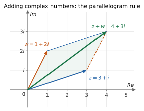
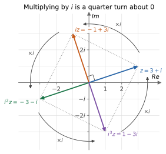
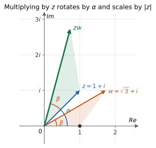

## Lecture 9: Complex Numbers and the Geometry of Multiplication

The equation $x^2+1=0$ has no real solution. In this lecture we enlarge
the real numbers by a new number $i$ with $i^2=-1$. We learn to add,
subtract, multiply, and divide the resulting **complex numbers**, and we
draw them as points in a plane. Addition is then the familiar
parallelogram rule. Multiplication is more surprising: written with the
help of the unit circle, multiplying two complex numbers **multiplies
their lengths and adds their angles**, and the reason is exactly the
angle-sum identities of Lecture 7. We finish with powers, roots, and a
preview of Euler's formula.

Unless a degree symbol appears, **all angles are in radians**. Throughout
this lecture, $k\in\mathbb Z$ means that $k$ is any integer.

### 1. The Imaginary Unit

Every real number has a nonnegative square, so $x^2+1\ge1$ for every
real $x$. Thus $x^2+1=0$ has no real solution: the parabola $y=x^2+1$
lies entirely above the $x$-axis.

Number systems have been enlarged before for the same reason. The
equation $x+3=0$ has no positive solution, so we admit negative numbers;
the equation $x^2=2$ has no rational solution, so we admit irrational
numbers such as $\sqrt2$. We now admit one more number.

**Definition.** The **imaginary unit** $i$ is a number with
$$
\boxed{i^2=-1}.
$$
A **complex number** is an expression
$$
z=a+bi,\qquad a,b\in\mathbb R.
$$
The real number $a$ is the **real part** of $z$, written
$\operatorname{Re}z$, and the real number $b$ is the **imaginary part**,
written $\operatorname{Im}z$. For example, the imaginary part of
$3-5i$ is $-5$, not $-5i$. The set of all complex numbers is denoted
$\mathbb C$.

When $b=0$, the number $z=a$ is real, so every real number is also a
complex number. When $a=0$ and $b\ne0$, the number $z=bi$ is called
**purely imaginary**. The names "real" and "imaginary" are historical;
complex numbers are no less legitimate than negative or irrational
numbers.

**Equality.** Two complex numbers are equal exactly when their real
parts agree and their imaginary parts agree:
$$
a+bi=c+di
\quad\Longleftrightarrow\quad
a=c\ \text{ and }\ b=d.
$$
Indeed, if $a+bi=c+di$ with $b\ne d$, then $i=(a-c)/(d-b)$ would be a
real number, but no real number has square $-1$. So $b=d$, and then
$a=c$. Thus **one equation between complex numbers contains two real
equations**.

**Square roots of negative numbers.** Both $i$ and $-i$ satisfy
$x^2=-1$, since $(-i)^2=(-1)^2i^2=-1$. More generally, for a real
number $c>0$,
$$
(\pm i\sqrt c)^2=i^2c=-c,
$$
so the equation $x^2=-c$ has the two solutions $x=\pm i\sqrt c$. We
define the **principal square root**
$$
\boxed{\sqrt{-c}=i\sqrt c,\qquad c>0}.
$$
For example, $\sqrt{-9}=3i$ and $\sqrt{-8}=i\sqrt8=2\sqrt2\,i$.

**Warning.** The rule $\sqrt a\,\sqrt b=\sqrt{ab}$ holds for $a,b\ge0$,
but it fails when $a$ and $b$ are both negative:
$$
\sqrt{-4}\,\sqrt{-9}=(2i)(3i)=6i^2=-6,
\qquad\text{but}\qquad
\sqrt{(-4)(-9)}=\sqrt{36}=6.
$$
Always rewrite $\sqrt{-c}$ as $i\sqrt c$ **before** multiplying.

**Powers of $i$.** The first four powers are
$$
i^1=i,\qquad i^2=-1,\qquad i^3=i^2\cdot i=-i,\qquad i^4=(i^2)^2=1.
$$
Since $i^4=1$, we have $i^{n+4}=i^n\cdot i^4=i^n$: the powers of $i$
repeat the cycle $i,-1,-i,1$ with period $4$. To evaluate $i^n$,
divide $n$ by $4$ and keep only the remainder.

**Example.** Since $2026=4\cdot506+2$,
$$
i^{2026}=\left(i^4\right)^{506}i^2=1\cdot(-1)=\boxed{-1}.
$$
Section 3 explains the period $4$ geometrically, and Section 8 explains
it with trigonometry.

**Exercise 1.** Write each number in the form $a+bi$:
$\sqrt{-49}$, $\sqrt{-12}$, $4-\sqrt{-18}$, and
$\bigl(6+\sqrt{-20}\bigr)/2$.

**Exercise 2.** Evaluate $i^7$, $i^{20}$, $i^{37}$, and $i^{2027}$.
Then show that $i^n+i^{n+1}+i^{n+2}+i^{n+3}=0$ for every positive
integer $n$.

**Exercise 3.** Compute $\sqrt{-2}\,\sqrt{-8}$ and
$\sqrt{-2}\,\sqrt{8}$. Compare them with $\sqrt{(-2)(-8)}$ and
$\sqrt{(-2)\cdot8}$. In which case does the product rule for square
roots survive?

**Exercise 4.** Find real numbers $x$ and $y$ such that
$(x+2y)+(x-y)i=7+i$.

### 2. The Complex Plane, Addition, and Subtraction

**Arithmetic.** Add and subtract complex numbers part by part, treating
$i$ like a variable and collecting like terms:
$$
(a+bi)+(c+di)=(a+c)+(b+d)i,
$$
$$
(a+bi)-(c+di)=(a-c)+(b-d)i.
$$
For example, $(3+i)+(1+2i)=4+3i$ and $(3+i)-(1+2i)=2-i$. Because real
and imaginary parts are added separately, the usual commutative and
associative laws still hold.

**The complex plane.** A complex number $a+bi$ is determined by the
ordered pair $(a,b)$, so we draw it as the point $(a,b)$. The
horizontal axis is called the **real axis** and the vertical axis the
**imaginary axis**. For example, $i$ is the point $(0,1)$ and $-1$ is
the point $(-1,0)$.

It also helps to draw $z$ as an **arrow** from $0$ to the point $z$.
Adding coordinates places the arrows tip to tail, so $0$, $z$, $z+w$,
and $w$ are the vertices of a parallelogram. This is the
**parallelogram rule**.

{width=360px}

**Subtraction.** The number $z-w$ is what must be added to $w$ to reach
$z$. Hence the arrow from $w$ to $z$ has the same length and direction
as the arrow from $0$ to $z-w$.

**Modulus.** The **modulus** (or absolute value) of $z=a+bi$ is its
distance from $0$:
$$
\boxed{|z|=|a+bi|=\sqrt{a^2+b^2}}.
$$
For a real number $a$, this gives $|a+0i|=\sqrt{a^2}=|a|$, the usual
absolute value, which explains the notation. For example,
$|3-4i|=\sqrt{9+16}=5$ and $\lvert-2i\rvert=2$.

Because subtraction subtracts coordinates, $|z-w|$ is the **distance
between the points $z$ and $w$**. With $z=a+bi$ and $w=c+di$,
$$
|z-w|=\sqrt{(a-c)^2+(b-d)^2},
$$
which is the distance formula of Lecture 1.

**Example (a distance).** The distance between $2+3i$ and $-1-i$ is
$$
\bigl|(2+3i)-(-1-i)\bigr|=|3+4i|=\sqrt{9+16}=\boxed5.
$$

**Example (a circle).** The set of complex numbers $z$ with $|z-c|=r$
is the circle with center $c$ and radius $r$. For instance, writing
$z=x+yi$, the equation $|z-(1-2i)|=3$ becomes
$$
\sqrt{(x-1)^2+(y+2)^2}=3,
\qquad\text{that is,}\qquad
(x-1)^2+(y+2)^2=9,
$$
the circle with center $(1,-2)$ and radius $3$. In particular, the
equation $|z|=1$ describes the **unit circle**.

**Triangle inequality.** The triangle with vertices $0$, $z$, and $z+w$
has sides of lengths $|z|$, $|w|$ (from $z$ to $z+w$), and $|z+w|$.
One side of a triangle is never longer than the other two together, so
$$
|z+w|\le|z|+|w|.
$$
Equality holds exactly when the arrows for $z$ and $w$ point in the
same direction, or when one of them is $0$.

**Exercise 5.** Let $z=5-2i$ and $w=-1+4i$. Compute $z+w$, $z-w$,
and $2z-3w$. Plot $z$, $w$, and $z+w$, and check the parallelogram
rule.

**Exercise 6.** Find $\lvert-5+12i\rvert$, $|2-2i|$, and
$\lvert-7i\rvert$. Then find the distance between $1+i$ and $4-3i$.

**Exercise 7.** Describe each set of points in the plane. Justify your
answer by writing $z=x+yi$.
(a) $|z-2i|=3$. (b) $|z-1|=|z+1|$.

### 3. Multiplication

To multiply, use the distributive law and then replace $i^2$ by $-1$:
$$
(a+bi)(c+di)=ac+adi+bci+bdi^2
=\boxed{(ac-bd)+(ad+bc)i}.
$$
There is no need to memorize this formula; simply expand.

**Example.**
$$
(2+3i)(4-i)=8-2i+12i-3i^2=8+10i+3=\boxed{11+10i}.
$$

**Example.** $(1+i)^2=1+2i+i^2=\boxed{2i}$. Consequently
$(1+i)^4=(2i)^2=4i^2=-4$.

**Example.** $(3+2i)(3-2i)=9-6i+6i-4i^2=9+4=\boxed{13}$. The product
of these two non-real numbers is real; we return to this below.

Complex multiplication obeys the commutative, associative, and
distributive laws, so algebra with complex numbers works just like
algebra with real numbers, with $i^2$ replaced by $-1$.

Multiplying by a positive real number $t$ multiplies both coordinates by
$t$: it stretches the arrow by the factor $t$ without turning it.
Multiplying by $i$ does something new.

**Multiplying by $i$ is a quarter turn.** For $z=a+bi$,
$$
iz=ai+bi^2=-b+ai,
$$
so the point $(a,b)$ moves to $(-b,a)$. The two points have the same
distance $\sqrt{a^2+b^2}$ from $0$. When $a$ and $b$ are nonzero, the
slopes $b/a$ and $a/(-b)$ of the two arrows multiply to $-1$, so the
arrows are perpendicular (Lecture 1). Points on the axes can be checked
directly, for example $1\mapsto i\mapsto-1$. Therefore

**multiplying by $i$ rotates every point a quarter turn ($\pi/2$)
counterclockwise about $0$.**

Two quarter turns make a half turn, which sends every $z$ to $-z$; this
is the geometric meaning of $i^2=-1$. Four quarter turns make a full
turn, which is why $i^4=1$ and the powers of $i$ repeat with period
$4$.

{width=360px}

**The conjugate.** The **complex conjugate** of $z=a+bi$ is
$$
\overline z=a-bi.
$$
Geometrically, $\overline z$ is the reflection of $z$ across the real
axis. Multiplying $z$ by its conjugate always gives a nonnegative real
number:
$$
z\,\overline z=(a+bi)(a-bi)=a^2-b^2i^2
=\boxed{a^2+b^2=|z|^2}.
$$
Also
$$
z+\overline z=2a=2\operatorname{Re}z,
\qquad
z-\overline z=2bi=2i\operatorname{Im}z,
$$
so $z$ is real exactly when $z=\overline z$. Conjugation respects
arithmetic:
$$
\overline{z+w}=\overline z+\overline w,
\qquad
\overline{zw}=\overline z\;\overline w.
$$
The first follows directly from the definition; the second is
Exercise 10.

**Exercise 8.** Write in the form $a+bi$: $(4-3i)(2+5i)$, $(1-i)^2$,
$(2+i)^3$, and $(\sqrt3+i)(\sqrt3-i)$.

**Exercise 9.** Compute $-i(a+bi)$ and describe how the point $(a,b)$
moves. Use this to rotate the point $(5,2)$ a quarter turn
**clockwise** about the origin.

**Exercise 10.** Let $z=a+bi$ and $w=c+di$. Prove
$\overline{zw}=\overline z\;\overline w$ by computing both sides.

**Exercise 11.** Find all complex numbers $z=x+yi$ with
$z^2=-3+4i$. Equate real and imaginary parts to obtain two real
equations for $x$ and $y$.

### 4. Division

To divide by $w=c+di\ne0$, multiply the numerator and denominator by
$\overline w$. The new denominator $w\,\overline w=c^2+d^2$ is a
positive real number:
$$
\frac{a+bi}{c+di}
=\frac{(a+bi)(c-di)}{(c+di)(c-di)}
=\frac{(ac+bd)+(bc-ad)i}{c^2+d^2}.
$$
This is the same idea as rationalizing a denominator, as in Lecture 8:
$$
\frac1{2+\sqrt3}
=\frac{2-\sqrt3}{(2+\sqrt3)(2-\sqrt3)}
=2-\sqrt3.
$$
There, multiplying by $2-\sqrt3$ removed the square root from the
denominator; here, multiplying by $\overline w$ removes $i$.

**Example.**
$$
\frac{3+4i}{1-2i}
=\frac{(3+4i)(1+2i)}{(1-2i)(1+2i)}
=\frac{3+6i+4i+8i^2}{1+4}
=\frac{-5+10i}{5}
=\boxed{-1+2i}.
$$
Check by multiplying back:
$(-1+2i)(1-2i)=-1+2i+2i-4i^2=3+4i$, as required.

**Reciprocals.** Taking the numerator to be $1$ gives
$$
\boxed{\frac1z=\frac{\overline z}{|z|^2}},\qquad z\ne0.
$$
For example, $1/i=-i$ (indeed $i\cdot(-i)=-i^2=1$), and
$$
\frac1{1+i}=\frac{1-i}{2}=\frac12-\frac12i.
$$
Negative powers of $i$ continue the cycle of Section 1:
$i^{-1}=-i$, $i^{-2}=-1$, and so on.

Every nonzero complex number has a reciprocal, while $0$ does not.
Consequently the **zero-product property** still holds: if $zw=0$ and
$z\ne0$, multiplying by $1/z$ gives $w=0$. So we may solve equations
by factoring, exactly as with real numbers.

**Exercise 12.** Write in the form $a+bi$:
$$
\frac5{2-i},\qquad \frac{2+3i}{i},\qquad \frac{1+i}{1-i},\qquad
\frac{10+5i}{3+4i}.
$$

**Exercise 13.** Show that $1/z=\overline z$ whenever $|z|=1$. Use
this to write $1/(\cos\theta+i\sin\theta)$ in the form $a+bi$.

**Exercise 14.** Solve $(2+i)z-3=4i$ for $z$, and check your answer.

### 5. Quadratic Equations

Completing the square (Lecture 2) now solves every quadratic equation.

**Example.** Solve $x^2-4x+13=0$. Completing the square,
$$
x^2-4x+4=-9,\qquad (x-2)^2=-9,
$$
so $x-2=\pm\sqrt{-9}=\pm3i$, and
$$
\boxed{x=2\pm3i}.
$$
To check $x=2+3i$: $(2+3i)^2=4+12i+9i^2=-5+12i$, so
$$
(-5+12i)-4(2+3i)+13=(-5-8+13)+(12-12)i=0.
$$
The graph of $y=x^2-4x+13=(x-2)^2+9$ is a parabola with vertex
$(2,9)$ and no $x$-intercepts. Real solutions appear as $x$-intercepts;
complex solutions do not appear on the real graph at all. The graph
still records them: the vertex is at $x=2$, the common real part, and
its height $9=3^2$ is the square of the imaginary part.

**The quadratic formula.** For $ax^2+bx+c=0$ with real $a\ne0$, $b$,
and $c$, divide by $a$ and complete the square:
$$
x^2+\frac bax=-\frac ca,
\qquad
\left(x+\frac b{2a}\right)^2=\frac{b^2}{4a^2}-\frac ca=\frac{b^2-4ac}{4a^2}.
$$
Taking square roots, which is now possible even when the right side is
negative, gives
$$
\boxed{x=\frac{-b\pm\sqrt{b^2-4ac}}{2a}}.
$$
The **discriminant** $\Delta=b^2-4ac$ decides the type of solutions:

| Discriminant | Solutions | Graph of $y=ax^2+bx+c$ |
|:--|:--|:--|
| $\Delta>0$ | two real solutions | two $x$-intercepts |
| $\Delta=0$ | one real (double) solution | touches the $x$-axis at its vertex |
| $\Delta<0$ | two non-real solutions | no $x$-intercepts |

When $\Delta<0$, we have $\sqrt\Delta=i\sqrt{-\Delta}$, so the two
solutions are
$$
x=-\frac b{2a}\pm\frac{\sqrt{-\Delta}}{2a}\,i.
$$

**Conjugate pairs.** When $\Delta<0$, the two solutions are conjugates
of each other. This is no accident. If $z$ solves $az^2+bz+c=0$ with
real coefficients, conjugate both sides. Conjugation respects sums and
products and leaves the real numbers $a$, $b$, $c$, and $0$ unchanged,
so
$$
a\,\overline z^{\,2}+b\,\overline z+c=0.
$$
Thus $\overline z$ is also a solution. The same argument works for
polynomials of any degree with real coefficients: **non-real roots come
in conjugate pairs**.

**Factoring.** Over the complex numbers, every quadratic factors into
linear factors:
$$
x^2+1=(x-i)(x+i),\qquad
x^2-4x+13=\bigl(x-(2+3i)\bigr)\bigl(x-(2-3i)\bigr).
$$
To check the second, note that $(x-r_1)(x-r_2)=x^2-(r_1+r_2)x+r_1r_2$,
and here $r_1+r_2=4$ and $r_1r_2=(2+3i)(2-3i)=4+9=13$. More generally,
the **Fundamental Theorem of Algebra**, first proved by Gauss, states
that every polynomial of degree $n\ge1$ factors into $n$ linear factors
over $\mathbb C$. Once $i$ is admitted, no further new numbers are
needed to solve polynomial equations.

**Exercise 15.** Solve by completing the square:
$x^2+6x+10=0$ and $2x^2-2x+5=0$.

**Exercise 16.** Solve $x^2+x+1=0$ with the quadratic formula. Plot
both solutions in the complex plane and find their moduli.

**Exercise 17.** Find a quadratic equation $x^2+bx+c=0$ with real
coefficients that has $3-2i$ as a solution. What is the other
solution?

**Exercise 18.** Factor $x^4-16$ completely into linear factors over
$\mathbb C$, and list all four solutions of $x^4=16$.

### 6. Polar Form: Complex Numbers and the Unit Circle

In Lecture 5 we learned that the point on the unit circle at angle
$\theta$ is $(\cos\theta,\sin\theta)$. As a complex number, this point
is
$$
\cos\theta+i\sin\theta,
\qquad
\lvert\cos\theta+i\sin\theta\rvert=\sqrt{\cos^2\theta+\sin^2\theta}=1.
$$
Conversely, every complex number of modulus $1$ has this form. For
instance:

| $\theta$ | $0$ | $\pi/4$ | $\pi/2$ | $2\pi/3$ | $\pi$ | $3\pi/2$ |
|:--:|:--:|:--:|:--:|:--:|:--:|:--:|
| $\cos\theta+i\sin\theta$ | $1$ | $\frac{\sqrt2}2+\frac{\sqrt2}2i$ | $i$ | $-\frac12+\frac{\sqrt3}2i$ | $-1$ | $-i$ |

**Polar form.** Let $z=a+bi\ne0$ and $r=|z|$. The number
$z/r=a/r+(b/r)i$ has modulus $1$, so $z/r=\cos\theta+i\sin\theta$ for
some angle $\theta$. Multiplying by $r$,
$$
\boxed{z=r(\cos\theta+i\sin\theta)},
\qquad
r=|z|=\sqrt{a^2+b^2},
\quad
\cos\theta=\frac ar,
\quad
\sin\theta=\frac br.
$$
This is the **polar form** of $z$. The angle $\theta$ is called an
**argument** of $z$, written $\arg z$. Geometrically, $r$ is the
distance from $0$ to $z$, and $\theta$ is the angle from the positive
real axis to the arrow for $z$. The real and imaginary parts are
recovered by
$$
a=r\cos\theta,\qquad b=r\sin\theta.
$$

{width=345px}

An argument is determined only up to whole turns: $\theta$ and
$\theta+2k\pi$ describe the same number. We usually choose $\theta$ in
$[0,2\pi)$ or in $(-\pi,\pi]$. The number $0$ has modulus $0$ and no
well-defined argument.

**This is Lecture 8 again.** To write
$a\sin x+b\cos x=R\sin(x+\phi)$ in Lecture 8, we found
$R=\sqrt{a^2+b^2}$ and an angle $\phi$ with $\cos\phi=a/R$ and
$\sin\phi=b/R$. That is exactly the polar form of the complex number
$a+bi$: $R=|a+bi|$ and $\phi=\arg(a+bi)$. The quadrant rule is also
the same:

- if $a>0$, take $\theta=\arctan(b/a)$;
- if $a<0$, take $\theta=\arctan(b/a)+\pi$;
- if $a=0$, take $\theta=\pi/2$ when $b>0$ and $\theta=-\pi/2$ when
  $b<0$.

Check **both** $\cos\theta=a/r$ and $\sin\theta=b/r$.

**Example (special angles).** For $-1+\sqrt3\,i$, we have
$r=\sqrt{1+3}=2$, $\cos\theta=-1/2$, and $\sin\theta=\sqrt3/2$, so
$$
-1+\sqrt3\,i=2\left(\cos\frac{2\pi}3+i\sin\frac{2\pi}3\right).
$$
For $-3-3i$, we have $r=3\sqrt2$ and $\cos\theta=\sin\theta=-\sqrt2/2$,
so
$$
-3-3i=3\sqrt2\left(\cos\frac{5\pi}4+i\sin\frac{5\pi}4\right).
$$
The quadrant rule agrees: $a<0$, so $\theta=\arctan(1)+\pi=5\pi/4$.

**Example (not a special angle).** For $4-3i$, we have $r=5$ and
$a>0$, so $\theta=\arctan(-3/4)\approx-0.6435$:
$$
4-3i=5(\cos\theta+i\sin\theta),\qquad \theta=-\arctan\frac34.
$$
Indeed $\cos\theta=4/5$ and $\sin\theta=-3/5$, since $\theta$ lies in
quadrant IV.

**Example (polar to rectangular).**
$$
6\left(\cos\frac{5\pi}6+i\sin\frac{5\pi}6\right)
=6\left(-\frac{\sqrt3}2+\frac12i\right)
=\boxed{-3\sqrt3+3i}.
$$

**Exercise 19.** Write in polar form with $0\le\theta<2\pi$:
$1-i$, $-2\sqrt3+2i$, $-4$, and $3i$.

**Exercise 20.** Write in the form $a+bi$:
$2\bigl(\cos(3\pi/4)+i\sin(3\pi/4)\bigr)$ and
$10\bigl(\cos(-\pi/3)+i\sin(-\pi/3)\bigr)$.

**Exercise 21.** Write $-4-3i$ in polar form. Which of
$\arctan(3/4)$ and $\arctan(3/4)+\pi$ is an argument? Which complex
number of modulus $5$ has the other angle as its argument?

**Exercise 22.** If $z=r(\cos\theta+i\sin\theta)$, write
$\overline z$ and $-z$ in polar form. Describe each geometrically.

### 7. The Geometric Meaning of Multiplication

We now multiply two complex numbers written in polar form. The
angle-sum identities from Lecture 7 do all of the work.

**Theorem (multiply lengths, add angles).** If
$$
z=r(\cos\alpha+i\sin\alpha)
\qquad\text{and}\qquad
w=s(\cos\beta+i\sin\beta),
$$
then
$$
\boxed{zw=rs\bigl(\cos(\alpha+\beta)+i\sin(\alpha+\beta)\bigr)}.
$$
In words: $|zw|=|z|\,|w|$, and $\arg(zw)=\arg z+\arg w$ up to whole
turns.

**Proof.** Expand, use $i^2=-1$, and group the real and imaginary
parts:
$$
\begin{aligned}
(\cos\alpha+i\sin\alpha)(\cos\beta+i\sin\beta)
&=\cos\alpha\cos\beta+i\cos\alpha\sin\beta
  +i\sin\alpha\cos\beta+i^2\sin\alpha\sin\beta\\
&=(\cos\alpha\cos\beta-\sin\alpha\sin\beta)
  +i(\sin\alpha\cos\beta+\cos\alpha\sin\beta)\\
&=\cos(\alpha+\beta)+i\sin(\alpha+\beta).
\end{aligned}
$$
The real part is the cosine sum formula, and the imaginary part is the
sine sum formula. Multiplying by $rs$ completes the proof. $\square$

The minus sign in $\cos(\alpha+\beta)=\cos\alpha\cos\beta-\sin\alpha\sin\beta$
comes from $i^2=-1$. A single complex multiplication carries **both**
angle-sum identities. If you remember
$$
(\cos\alpha+i\sin\alpha)(\cos\beta+i\sin\beta)=\cos(\alpha+\beta)+i\sin(\alpha+\beta),
$$
you can always recover them by expanding the left side.

**Geometric meaning.** Fix $w=s(\cos\beta+i\sin\beta)$. By the
theorem, multiplying any complex number $z$ by $w$

1. **rotates** $z$ counterclockwise about $0$ through the angle
   $\beta=\arg w$, and
2. **scales** the distance of $z$ from $0$ by the factor $s=|w|$.

| Multiply by | $\lvert w\rvert$ | $\arg w$ | Effect on the plane |
|:--|:--:|:--:|:--|
| $t>0$ (real) | $t$ | $0$ | stretch by the factor $t$, no turning |
| $i$ | $1$ | $\pi/2$ | quarter turn (Section 3) |
| $-1$ | $1$ | $\pi$ | half turn: $z\mapsto-z$ |
| $\cos\beta+i\sin\beta$ | $1$ | $\beta$ | rotation through $\beta$ |

In particular, $i\cdot i=-1$ says that two quarter turns make a half
turn.

**Similar triangles.** Multiplication by $z$ rotates and scales the
whole plane, and it sends $0\mapsto0$, $1\mapsto z$, and
$w\mapsto zw$. Therefore it carries the triangle with vertices $0$,
$1$, $w$ onto the triangle with vertices $0$, $z$, $zw$. The two
triangles are **similar**, with ratio $|z|$. This gives a
ruler-and-compass construction of the product.

{width=340px}

**Example (multiply two ways).** Let $z=1+i$ and $w=\sqrt3+i$, as in
the figure. Directly,
$$
zw=(1+i)(\sqrt3+i)=\sqrt3+i+\sqrt3\,i+i^2
=(\sqrt3-1)+(\sqrt3+1)i.
$$
In polar form, $z=\sqrt2\bigl(\cos\frac\pi4+i\sin\frac\pi4\bigr)$ and
$w=2\bigl(\cos\frac\pi6+i\sin\frac\pi6\bigr)$, so by the theorem
$$
zw=2\sqrt2\left(\cos\frac{5\pi}{12}+i\sin\frac{5\pi}{12}\right).
$$
Comparing real and imaginary parts gives exact values:
$$
\cos\frac{5\pi}{12}=\frac{\sqrt3-1}{2\sqrt2}=\boxed{\frac{\sqrt6-\sqrt2}4},
\qquad
\sin\frac{5\pi}{12}=\frac{\sqrt3+1}{2\sqrt2}=\boxed{\frac{\sqrt6+\sqrt2}4},
$$
in agreement with Lecture 7. As a check on the lengths,
$(\sqrt3-1)^2+(\sqrt3+1)^2=8=\bigl(2\sqrt2\bigr)^2$.

**Example (rotating a point).** Rotate the point $(4,2)$
counterclockwise about the origin through $\pi/3$. Multiply $4+2i$ by
$\cos\frac\pi3+i\sin\frac\pi3=\frac12+\frac{\sqrt3}2i$:
$$
(4+2i)\left(\frac12+\frac{\sqrt3}2i\right)
=2+2\sqrt3\,i+i+\sqrt3\,i^2
=(2-\sqrt3)+(1+2\sqrt3)i.
$$
The image is the point $\boxed{(2-\sqrt3,\ 1+2\sqrt3)}$. The same
computation with a general point $x+yi$ and angle $\theta$ gives
$$
(x+yi)(\cos\theta+i\sin\theta)
=(x\cos\theta-y\sin\theta)+(x\sin\theta+y\cos\theta)i,
$$
so the **rotation through $\theta$** about the origin sends $(x,y)$ to
$$
(x\cos\theta-y\sin\theta,\ x\sin\theta+y\cos\theta).
$$
The proof of the cosine sum formula in Lecture 7 did not need a
coordinate formula for rotation; complex multiplication now supplies
one.

**Example (Lecture 8 revisited).** For real $a$ and $b$,
$$
(a+bi)(\cos x+i\sin x)=(a\cos x-b\sin x)+i(a\sin x+b\cos x),
$$
so $a\sin x+b\cos x$ is the imaginary part of
$(a+bi)(\cos x+i\sin x)$. Write $a+bi=R(\cos\phi+i\sin\phi)$ in polar
form. By the theorem, the product equals
$R\bigl(\cos(x+\phi)+i\sin(x+\phi)\bigr)$, whose imaginary part is
$R\sin(x+\phi)$. Hence
$$
a\sin x+b\cos x=R\sin(x+\phi),
\qquad R=|a+bi|,\quad \phi=\arg(a+bi),
$$
which is the main result of Lecture 8, Section 8.

**Division.** For $w\ne0$,
$$
\boxed{\frac zw=\frac rs\bigl(\cos(\alpha-\beta)+i\sin(\alpha-\beta)\bigr)}.
$$
To prove it, multiply the right side by $w=s(\cos\beta+i\sin\beta)$.
By the theorem, the product has modulus $(r/s)\cdot s=r$ and argument
$(\alpha-\beta)+\beta=\alpha$, so it equals $z$. Since $z/w$ is the
only number whose product with $w$ is $z$, the formula holds.
**Dividing divides lengths and subtracts angles.** In particular,
$$
\frac1w=\frac1s\bigl(\cos(-\beta)+i\sin(-\beta)\bigr),
$$
which undoes both the rotation and the scaling of multiplication by
$w$.

**Exercise 23.** Let $z=3\bigl(\cos\frac{2\pi}9+i\sin\frac{2\pi}9\bigr)$
and $w=2\bigl(\cos\frac\pi9+i\sin\frac\pi9\bigr)$. Find $zw$ and $z/w$
in polar form, and write $zw$ in the form $a+bi$.

**Exercise 24.** Compute $(1+\sqrt3\,i)(1+i)$ directly and in polar
form. Use the two answers to find exact values of $\cos(7\pi/12)$ and
$\sin(7\pi/12)$.

**Exercise 25.** Rotate the point $(2,-1)$ about the origin through
$\pi/4$ counterclockwise. Then, separately, rotate $(2,-1)$ a quarter
turn clockwise.

**Exercise 26.** Find the complex number $w$ such that multiplication
by $w$ rotates every point clockwise through $\pi/6$ about $0$ and
doubles its distance from $0$. Write $w$ in the form $a+bi$.

**Exercise 27.** Use polar form to explain why $z\,\overline z$ is
always a nonnegative real number. Compare with Exercise 22.

### 8. Powers and De Moivre's Formula

Multiplying $z=r(\cos\theta+i\sin\theta)$ by itself multiplies the
modulus by $r$ and adds $\theta$ to the argument each time. Hence:

**De Moivre's formula.** For every positive integer $n$,
$$
\boxed{\bigl[r(\cos\theta+i\sin\theta)\bigr]^n=r^n(\cos n\theta+i\sin n\theta)}.
$$
By the reciprocal formula of Section 7, it also holds for $n=0$ and for
negative integers $n$ when $r\ne0$.

**Example.** Compute $(1+i)^{10}$. Since
$1+i=\sqrt2\bigl(\cos\frac\pi4+i\sin\frac\pi4\bigr)$,
$$
(1+i)^{10}
=(\sqrt2)^{10}\left(\cos\frac{10\pi}4+i\sin\frac{10\pi}4\right)
=32\left(\cos\frac{5\pi}2+i\sin\frac{5\pi}2\right)
=\boxed{32i}.
$$
Check: $(1+i)^2=2i$, so $(1+i)^{10}=(2i)^5=32i^5=32i$.

**Example.** Compute $(\sqrt3+i)^7$. Expanding seven factors by hand
would be painful, but $\sqrt3+i=2\bigl(\cos\frac\pi6+i\sin\frac\pi6\bigr)$,
so
$$
(\sqrt3+i)^7
=2^7\left(\cos\frac{7\pi}6+i\sin\frac{7\pi}6\right)
=128\left(-\frac{\sqrt3}2-\frac12i\right)
=\boxed{-64\sqrt3-64i}.
$$

**Powers of $i$ again.** Since $i=\cos\frac\pi2+i\sin\frac\pi2$,
De Moivre's formula gives
$$
i^n=\cos\frac{n\pi}2+i\sin\frac{n\pi}2.
$$
The period $4$ of the powers of $i$ is the period $2\pi$ of sine and
cosine: replacing $n$ by $n+4$ adds $2\pi$ to the angle.

**New identities from old.** Write $c=\cos\theta$ and $s=\sin\theta$.
Expanding the left side of De Moivre's formula and comparing real and
imaginary parts produces multiple-angle identities.

For $n=2$: $(c+is)^2=c^2-s^2+2ics$, while De Moivre's formula gives
$\cos2\theta+i\sin2\theta$. Hence
$$
\cos2\theta=\cos^2\theta-\sin^2\theta,
\qquad
\sin2\theta=2\sin\theta\cos\theta,
$$
the double-angle formulas of Lecture 7, both at once.

For $n=3$, use $(x+y)^3=x^3+3x^2y+3xy^2+y^3$ with $x=c$ and $y=is$,
together with $i^2=-1$ and $i^3=-i$:
$$
(c+is)^3=c^3+3ic^2s-3cs^2-is^3=(c^3-3cs^2)+i(3c^2s-s^3).
$$
Compare with $\cos3\theta+i\sin3\theta$, then use $s^2=1-c^2$ in the
real part and $c^2=1-s^2$ in the imaginary part:
$$
\boxed{\cos3\theta=4\cos^3\theta-3\cos\theta},
\qquad
\boxed{\sin3\theta=3\sin\theta-4\sin^3\theta}.
$$
Check at $\theta=\pi/3$: $\cos\pi=-1$ and
$4\cdot\frac18-3\cdot\frac12=-1$.

**Exercise 28.** Use De Moivre's formula to compute $(1-i)^8$ and
$(\sqrt3+i)^6$.

**Exercise 29.** Compute $(-1+i)^5$ in the form $a+bi$, first with
De Moivre's formula and then by using $(-1+i)^2=-2i$.

**Exercise 30.** Use $n=4$ in De Moivre's formula and
$(x+y)^4=x^4+4x^3y+6x^2y^2+4xy^3+y^4$ to express $\cos4\theta$ and
$\sin4\theta$ in terms of $\cos\theta$ and $\sin\theta$. Check your
formula for $\cos4\theta$ at $\theta=\pi/4$.

**Exercise 31.** Use the triple-angle formula to show that
$x=\cos(\pi/9)$ is a solution of $8x^3-6x-1=0$.

### 9. Roots and Roots of Unity

**Example (the cube roots of $1$).** Solve $z^3=1$. The only real
solution is $z=1$, but we want all complex solutions. Write
$z=\rho(\cos\varphi+i\sin\varphi)$ with $\rho>0$. By De Moivre's
formula,
$$
\rho^3(\cos3\varphi+i\sin3\varphi)=1=1\cdot(\cos0+i\sin0).
$$
Equal complex numbers have equal moduli, so $\rho^3=1$ and $\rho=1$.
Then $\cos3\varphi+i\sin3\varphi$ and $\cos0+i\sin0$ are the same point
of the unit circle, so their angles differ by a whole number of turns:
$3\varphi=2k\pi$, that is,
$$
\varphi=\frac{2k\pi}3.
$$
The values $k=0,1,2$ give three different points. The value $k=3$
gives $\varphi=2\pi$, the same point as $k=0$, and from there the list
repeats. Therefore $z^3=1$ has exactly three solutions:
$$
\boxed{1,\qquad -\frac12+\frac{\sqrt3}2i,\qquad -\frac12-\frac{\sqrt3}2i}.
$$
Algebra confirms this: $z^3-1=(z-1)(z^2+z+1)$, and the quadratic
formula gives the roots $\bigl(-1\pm\sqrt3\,i\bigr)/2$ of $z^2+z+1$
(Exercise 16).

**The general rule.** Let $w=s(\cos\beta+i\sin\beta)\ne0$, and let $n$
be a positive integer. The same reasoning shows that $z^n=w$ has
exactly $n$ solutions:
$$
\boxed{z_k=\sqrt[n]s\left(\cos\frac{\beta+2k\pi}n+i\sin\frac{\beta+2k\pi}n\right),
\qquad k=0,1,\dots,n-1}.
$$
They all lie on the circle of radius $\sqrt[n]s$ centered at $0$, and
consecutive roots are $2\pi/n$ apart: they are the **vertices of a
regular $n$-gon**. As in Lecture 8, solving for the angle divides
$2k\pi$ by $n$; that is why $n$ different points appear before the
list repeats.

**Roots of unity.** The solutions of $z^n=1$ are the **$n$th roots of
unity**,
$$
\cos\frac{2k\pi}n+i\sin\frac{2k\pi}n,\qquad k=0,1,\dots,n-1.
$$
They divide the unit circle into $n$ equal arcs, starting at $1$. The
sixth roots of unity form a regular hexagon, and every other one of
them is a cube root of unity.

{width=350px}

**Example (square roots of $i$).** Since
$i=\cos\frac\pi2+i\sin\frac\pi2$, the solutions of $z^2=i$ are
$$
z=\cos\left(\frac\pi4+k\pi\right)+i\sin\left(\frac\pi4+k\pi\right),
\quad k=0,1,
\qquad\text{so}\qquad
\boxed{z=\pm\left(\frac{\sqrt2}2+\frac{\sqrt2}2i\right)}.
$$
This agrees with Section 3: $(1+i)^2=2i$, so
$\bigl((1+i)/\sqrt2\bigr)^2=i$.

**Example (four roots forming a square).** Solve $z^4=-16$. Since
$-16=16(\cos\pi+i\sin\pi)$ and $\sqrt[4]{16}=2$,
$$
z=2\left(\cos\frac{\pi+2k\pi}4+i\sin\frac{\pi+2k\pi}4\right),
\qquad k=0,1,2,3.
$$
The angles are $\pi/4$, $3\pi/4$, $5\pi/4$, and $7\pi/4$, so
$$
\boxed{z=\sqrt2+\sqrt2\,i,\quad -\sqrt2+\sqrt2\,i,\quad
-\sqrt2-\sqrt2\,i,\quad \sqrt2-\sqrt2\,i},
$$
the vertices of a square centered at $0$.

**Exercise 32.** Solve $z^4=16$ using polar form, and compare with
Exercise 18. Then list the six sixth roots of unity in the form
$a+bi$.

**Exercise 33.** Find the three solutions of $z^3=8i$ in the form
$a+bi$, and plot them. Check one solution by cubing it.

**Exercise 34.** Find both square roots of $1+\sqrt3\,i$ in the form
$a+bi$. Check one by squaring it.

**Exercise 35.** Let $\omega=\cos\frac{2\pi}3+i\sin\frac{2\pi}3$.
Show that $1+\omega+\omega^2=0$ in two ways: by computing with the
$a+bi$ forms, and by factoring $\omega^3-1$. What does this say about
the centroid (Lecture 1) of the triangle with vertices $1$, $\omega$,
and $\omega^2$?

### 10. Looking Ahead: Euler's Formula

Write $E(\theta)=\cos\theta+i\sin\theta$ for the point of the unit
circle at angle $\theta$. Sections 7 and 8 showed that
$$
E(\alpha)\,E(\beta)=E(\alpha+\beta),
\qquad
E(\theta)^n=E(n\theta),
\qquad
E(0)=1.
$$
These are the laws of exponents $a^xa^y=a^{x+y}$ and
$(a^x)^n=a^{nx}$ from Lecture 3. In calculus one shows that the natural
exponential function extends to complex inputs in exactly this way:
$$
\boxed{e^{i\theta}=\cos\theta+i\sin\theta}
\qquad\text{(Euler's formula)}.
$$
With this notation, the polar form becomes $z=re^{i\theta}$, the
multiplication theorem becomes
$re^{i\alpha}\cdot se^{i\beta}=rs\,e^{i(\alpha+\beta)}$, and
De Moivre's formula is simply $\left(e^{i\theta}\right)^n=e^{in\theta}$.
Setting $\theta=\pi$ gives the famous identity
$$
e^{i\pi}+1=0,
$$
which connects the five constants $0$, $1$, $i$, $\pi$, and $e$. For
now, treat $e^{i\theta}$ as shorthand for $\cos\theta+i\sin\theta$;
the justification of Euler's formula requires calculus.
